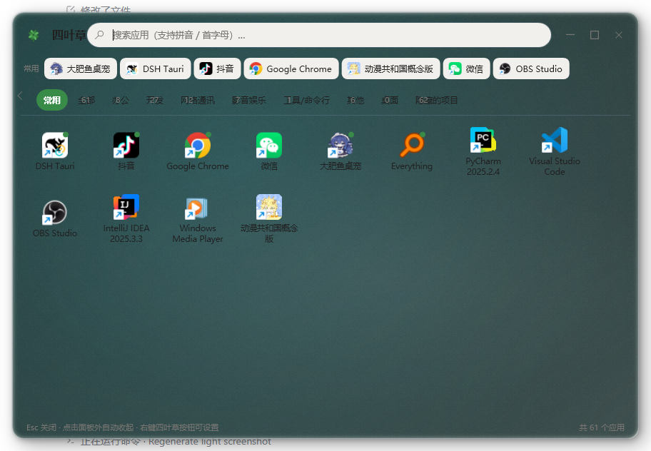
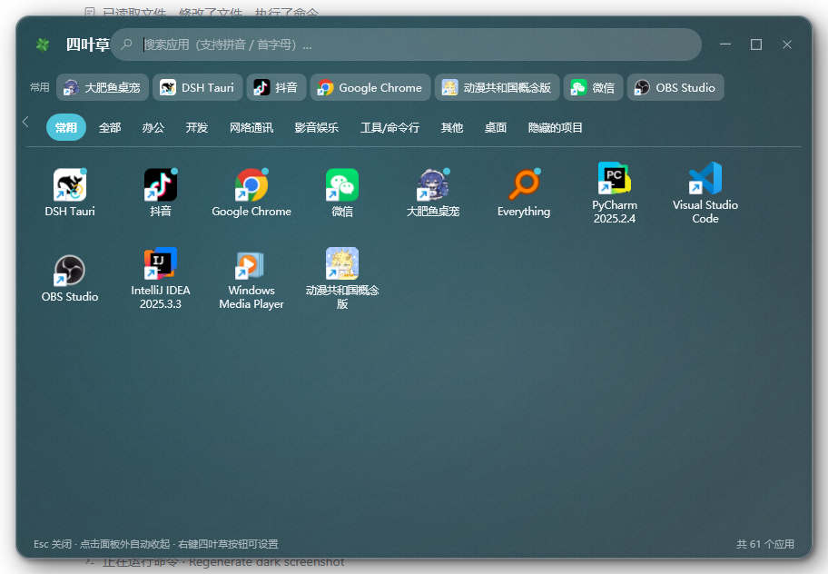

# 四叶草启动面板 (CloverStart)

轻量级 Windows 11 开始菜单替代面板：任务栏左下角悬浮一个四叶草按钮，点开就是一屏按分类整理好的全部软件。



深色主题（右键四叶草 →「主题」切换，默认跟随 Windows）：



## 它解决什么

三件事合在一个面板里，不用在「开始菜单 / 资源管理器 / 桌面」之间来回切：

| 场景 | 原来的做法 | 现在 |
|---|---|---|
| 找软件 | 开始菜单滚半天 / 桌面找图标 | 分类磁贴 + 拼音搜索 |
| 找程序 | 记不住在哪 | **系统级搜索**：已安装应用 + 开始菜单 + 注册表一起搜 |

## 使用

- 点击任务栏里的四叶草按钮，或按 `Ctrl + Alt + 空格`，打开 / 收起面板
- 按钮是任务栏里的一个独立按钮（44×48，原生样式、悬停高亮），位于应用按钮组末尾并自动跟随；不会遮挡任何图标
- **"运行中"小圆点**：正在运行的应用，图标右上角会有一个小圆点
- 面板窗口可以像普通软件一样**拖动**（按住顶部标题区拖动）和**调整大小**（拖四边或四角），位置和尺寸保存在 `config\layout.json`
- **重启后回到原样**：面板位置由 `layout.json` 记住，**上次浏览的分类**由 `config\last-category.json` 记住。配合 `dev-run.ps1` 反复重启调界面时，不用每次重新找位置和分类
- 右上角两个窗口按钮：**□ 最大化·还原**（铺满整个屏幕，再点一次还原）/ **✕ 关闭**（收起面板）。原「最小化」已移除——它和「关闭」行为完全一样
- **顶部默认三个标签：常用 / 全部 / 文件**，点一下切换（`showFilesTab=false` 时只有前两个）
  - 选中的标签是**实色强调底 + 白字**，未选中的透明底
  - 「常用」按启动次数排序（最多 12 个）；为空时自动切到「全部」
  - 「全部」按名称排序：中文逐字拼音、英文不区分大小写、数字排最前
  - 真商店应用显示为 `名字 ·商店`；出现在 `shell:AppsFolder` 里的传统软件（如 Chrome）不加后缀
- **分类栏可以收起**：点分类栏左侧的小箭头，整条收起来把高度让给磁贴区；再点一下展开。**收起状态会被记住**（存 `settings.json` 的 `navCollapsed`）
- **主题**：右键四叶草 →「主题」可在**浅色 / 深色 / 跟随系统**之间切换，**默认跟随系统**（读 Windows 的「应用模式」设置）。切换立刻生效，不用重启
- **切分类会记住各自滚到哪**：在「全部」滚到第 3 屏，切到「常用」再切回来，仍在第 3 屏（按分类分别记，不是全局一个偏移）
- 应用图标按**使用频率**排序：从面板启动次数越多越靠前，次数相同按最近使用，没用过的按名称；数据保存在 `config\usage.json`（删掉即可重置）
- **应用磁贴可以拖动排序**：按住一个磁贴拖动，它会**浮起来**（放大 + 阴影）跟着鼠标走，其他磁贴**平滑让位**；松手后落到新位置，顺序按分类保存到 `config\order.json`。删掉该文件恢复按使用频率排序
- 顶部搜索框：输入即过滤，支持中文、英文，以及**拼音**——全拼（`weixin` → 微信）和首字母（`wx` → 微信）都行。**同时搜三类**：已安装应用（带拼音）、开始菜单里的快捷方式、注册表里的程序（全部同步返回，不搜磁盘文件）
- **键盘操作**：面板弹出即聚焦搜索框；`↑ ↓ ← →` 在磁贴间移动选中（选中项有绿色边框），`Home`/`End` 跳到第一个/最后一个，`Enter` 启动选中项（未选中时启动第一个），`Esc` 关闭。在搜索框里按 `←` `→` 仍是移动光标，只有 `↑` `↓` `Enter` 会接管
- 点击应用图标直接启动；`Esc` 或点击面板外自动收起
- 「常用」里右键应用磁贴 → **从常用移除**（清掉该应用的启动次数记录，它仍保留在原分类和「全部」里）；这个菜单项只在「常用」分类里出现
- **所有分类**里右键应用磁贴 → **打开文件所在位置**：在资源管理器里打开该应用所在目录并选中它。`.lnk` 会先解析出真实目标再定位（不是定位到开始菜单里那个快捷方式）；文件已被卸载但目录还在时直接打开目录；两者都不存在时给出提示
- ~~移到分类 / 恢复自动分类~~：**已移除**。分类标签只剩两个，手工归类没有意义了。数据层（`config\category-overrides.json`）保留，已有的覆盖记录仍然生效，只是界面不再提供修改入口
- **所有分类**里右键应用磁贴 → **从面板隐藏**：把用不到的条目藏起来。藏起来的**不在「全部」里显示**，但**搜索时仍能找到**。清单存在 `config\hidden-apps.json`。恢复方式：右键四叶草 →「隐藏用不到的 ▸」→「查看隐藏的项目」弹窗逐个恢复，或「取消隐藏全部」
- **任务栏窗口列表**：分类栏下方列出当前打开的所有窗口（图标 + 标题），点一下切换到该窗口；当前前台窗口高亮，每 1.5 秒自动刷新
- 任务栏里的窗口项右键 → **切换到该窗口** / **最小化** / **关闭窗口** / 显示在任务栏（把按钮放到左下角）；左下角的按钮右键可关闭窗口或从任务栏移除，窗口关掉后按钮自动消失
- 右键**四叶草按钮** → **诊断**：
  - **任务栏定位**：显示任务栏在哪条边、多厚、几何来源、是否已用 UIAutomation 精确校准、DPI、按钮矩形。定位降级时会给出原因和影响
  - **运行状态**：异常退出计数、是否处于安全模式、内存/句柄、看门狗心跳。**安全模式下这里可以直接退出安全模式**
- 右键四叶草 → **全屏时隐藏悬浮按钮** / **全屏时鼠标移过去临时显示**：两个开关控制看视频、玩游戏时的按钮行为

### 系统级搜索

搜索框**两路并行**，不是单一数据源：

| 路径 | 数据源 | 能力 | 耗时 |
|---|---|---|---|
| **主**：`MatchCatalog` | 已扫描进面板的 `Catalog.Apps`（175 条：开始菜单 123 + 商店 34 + 注册表 11 + AppsFolder 7）| **拼音匹配**（`wx` / `weixin` → 微信）、全拼、首字母 | < 1ms（内存遍历）|
| **补充**：`SystemSearch.Instant` | 现场扫开始菜单（递归 depth≤3）+ 注册表 App Paths / Uninstall | 能发现**没被扫进清单**的程序（`notepad` / `7z` / `code` 这类只在注册表里的）| 8–15ms |

**为什么两路都要**（实测数据）：

| 只用一路 | 丢失什么 |
|---|---|
| 只有 `MatchCatalog` | `notepad` / `7z` 搜不到（0 条）—— 它们在注册表 App Paths 里，但没被 `RegistryScanner` 收录 |
| 只有 `Instant` | `wx` / `weixin` 搜不到（0 条）—— 它只做子串匹配，**没有拼音** |

**合并规则**：

1. 主搜索结果先全部追加，**顺序不变**（名字长度 → 字母序）
2. 补充结果**总是执行**（不因主搜索有结果就跳过），追加在主结果之后
3. 去重用**双键**：
   - 路径键：`Path`（大小写不敏感）
   - 名字键：`Name.Trim().ToLowerInvariant()`
   - 为什么要名字键：同一应用在两路里路径不同 —— 微信 `...\微信.lnk` vs `...\Weixin.exe`、Steam `...\Steam.lnk` vs `...\uninstall.exe`、QQ `...\QQ.lnk` vs `...\QQ.exe`，但 **Name 完全相同**。只靠路径会显示 2 次
   - 为什么不用 `NameMatch.Normalize`：它丢所有非字母数字，会把 `Notepad++` 折成 `notepad` 与 `Notepad` 撞车。保守键 `Trim+小写` 能覆盖实测全部重复场景且不误伤
4. 统一上限 **60 条**（`MaxDisplay`），主结果优先占位

**只搜可启动的程序，不搜磁盘文件。** 找文件用资源管理器更合适。

- 结果按来源分组（「应用（已安装）」/「应用（开始菜单）」/「应用（注册表）」）
- 点结果直接打开；右键可打开所在位置 / 复制路径

### 外观（毛玻璃）

**右键四叶草 → 设置 ▸ → 外观…** 打开外观窗口，所有参数可视化调整，**拖动即时预览，松手才写盘**。

#### 六款预设

| 预设 | 浓度 | 模糊 | 染色 | 强度 | 亮度 | 强调色 | 主题 | 视觉特征 |
|---|---|---|---|---|---|---|---|---|
| **自定义** | *（保留你当前的值）* | — | — | — | — | — | 不改 | 手动调参后的状态 |
| **经典毛玻璃** | 80 | 10 | 空（用强调色）| 10 | 0 | 空 | 不改 | 柔和半透明，**与改动前的默认观感一致** |
| **磨砂玻璃** | 78 | 25 | `#DCE4E8` | 22 | +6 | 空 | 不改 | 发白发雾、强模糊 |
| **深色玻璃** | 92 | 12 | `#172A30` | 45 | -8 | `#4FC3D9` | **深色** | 深青厚重 |
| **浅色玻璃** | 65 | 8 | `#FFFFFF` | 30 | +18 | `#388C48` | **浅色** | 通透亮白 |
| **液态玻璃** | 45 | 3 | `#7FA8B8` | 26 | -18 | 空 | 不改 | 冷调清透 |

实测差异（912×632 面板截图，4px 步长采样全图平均 RGB）：

| 预设 | Avg R/G/B | 亮度 |
|---|---|---|
| 经典毛玻璃 | 84 / 106 / 107 | 100 |
| 磨砂玻璃 | 112 / 128 / 133 | 124 |
| 深色玻璃 | 68 / 86 / 93 | 82 |
| 浅色玻璃 | 129 / 142 / 146 | 139 |
| 液态玻璃 | 98 / 119 / 128 | 114 |

**10 对两两差异全部 ≥ 20**（最小 28），切换时肉眼可辨。

#### 可调参数

| 控件 | 键 | 范围 | 含义 |
|---|---|---|---|
| **浓度** | `glassOpacity` | 0-100 | 面板底色盖住壁纸的程度。**0 = 关闭玻璃**（纯色），越大越透出壁纸 |
| **模糊** | `glassBlur` | 0-30 | 底图模糊半径。固定图模式下差异较小，跟随桌面模式更明显 |
| **染色强度** | `glassTintStrength` | 0-100 | **染色层**的颜色浓度 |
| **亮度** | `glassBrightness` | -50 ~ +50 | 正值提亮、负值压暗（作用在模糊后的底图上）|
| **染色** | `glassTint` | `#RRGGBB` 或空 | 空 = 用当前强调色 |
| **强调色** | `glassAccent` | `#RRGGBB` 或空 | 空 = 用主题默认强调色 |
| **背景模式** | `glassMode` | `fixed` / `screen` | 固定青灰图 / 跟随桌面壁纸（截屏 + 模糊）|

> **「浓度」与「染色强度」不是一回事**：
> · **浓度** 管「多少面板色盖在壁纸上」→ 影响**透出多少**
> · **染色强度** 管「染色层多重」→ 影响**颜色多浓**
>
> 高浓度 + 低染色 = 不透明但无色；低浓度 + 高染色 = 很透但强色调（像彩色玻璃）。

#### 状态规则

| 操作 | 行为 |
|---|---|
| 点预设 | 一次性应用整组参数；`深色玻璃` / `浅色玻璃` 会顺带切主题，其余预设**不动主题** |
| 点「自定义」 | **只改预设名，不动任何参数**（保留你当前的值）|
| 手动拖滑块 / 选颜色 | 预设自动变成「自定义」，**保留修改后的效果** |
| 「恢复默认」 | 回到当前预设的初始值；当前是自定义时回退「经典毛玻璃」；**不改主题** |

#### 渲染管线（五层叠加）

```
outerLayer（圆角裁剪）
  └ Grid
      ├ innerLayer    底图 + BlurEffect（玻璃的"透"）
      ├ brightLayer   半透明白/黑（亮度 ±50）
      ├ tintLayer     半透明染色（颜色 + 强度）
      ├ grainLayer    64×64 噪点平铺（2.5%，固定不可调）
      └ highlightLayer 1px 内边缘高光（30%，固定不可调）
```

#### 性能

| 阶段 | 做什么 | 耗时 |
|---|---|---|
| 拖动滑块 | 120ms 防抖 → 只重跑合成（`Attach`），**不重新截屏** | 几毫秒 |
| 松手 | 写盘一次 + 全尺寸重算 | ~50ms |
| 启动 / 显示面板 | `RefreshGlassSoon` 延迟截屏 + 合成 | 50-150ms |

**关键**：截屏结果缓存在 `glassBackdrop.cached` 里，外观参数只影响合成阶段 —— 所以拖滑块不会反复截屏。

#### 已知视觉限制

| 限制 | 原因 |
|---|---|
| **磨砂玻璃不能靠噪点做** | `GrainStrength = 0.025` 写死不可调（不在可调键里），最大影响 2.5%（约 6/255）→ 靠**加大 blur + 白染色**近似 |
| **液态玻璃没有真正的折射** | WPF 无透镜/折射能力 → 只能靠**低浓度 + 低模糊 + 冷色染色**做"清透"感 |
| **固定图模式下模糊差异不明显** | 固定图本身就是柔和渐变，再模糊也看不出边界 → 预设差异靠**染色 + 亮度**实现 |
### 右键四叶草按钮的菜单

| 菜单项 | 说明 |
|---|---|
| 打开面板 | 同点击按钮 |
| 重新扫描应用 | 后台重新扫描开始菜单与便携软件 |
| **启用迷你任务栏** | 勾选项，默认开。关掉后左下角不再显示窗口按钮，`显示在任务栏` 菜单也失效 |
| **允许隐藏系统任务栏** | 勾选项，默认开。关掉会立即恢复任务栏，并禁用下面一项 |
| 隐藏系统任务栏 | 勾选项，默认关。勾上后整条系统任务栏隐藏，左下角只留「开始」+ 四叶草 |
| **隐藏用不到的** | 子菜单：一键隐藏整类（如「系统工具」「工具/命令行」共 60+ 个从没用过的条目）、整理与隐藏…（标签二）、取消隐藏全部。见下方「减少噪音」 |
| **设置 ▸ 外观…** | 打开外观窗口：毛玻璃预设、浓度/模糊/染色/亮度滑块、颜色选择、背景模式。见下方「外观（毛玻璃）」 |
| 设置 ▸ 主题 | 浅色 / 深色 / 跟随系统 |
| 开机自启 | 勾选项 |
| 退出 | 退出前会自动还原系统状态并清除运行标记 |

### 减少噪音：隐藏用不到的应用

面板默认列出**开始菜单里所有应用**，但常用的往往只有十几个。藏起来的两种方式：

| 方式 | 粒度 | 适合 |
|---|---|---|
| 右键单个应用 → **从面板隐藏** | 精确到一条 | 卸载残留、重复项 |
| 右键四叶草 → **隐藏用不到的** → 隐藏整类 | 整个分类 | 「系统工具」「工具/命令行」这类从没用过的 |

**隐藏后的行为**：

- 不在任何分类里显示，底部计数也不含它们
- **搜索时仍能找到**（主动搜名字说明就是要找它）
恢复：右键四叶草 →「整理与隐藏…」→ 标签二「已隐藏的应用」，可多选恢复 / 按组恢复 / 全部恢复
- 与「隐藏分类」的叠加已不存在：`hiddenCategories` 字段随分类系统下线移除，现在只有「逐条隐藏」一种方式

### 配置开关（config\settings.json）

| 键 | 默认 | 作用 |
|---|---|---|
| `hideTaskbar` | `false` | 隐藏系统任务栏（当前状态） |
| `taskbarHiding` | `true` | 是否**允许**隐藏系统任务栏这个功能 |
| `miniTaskbar` | `true` | 迷你任务栏 |
| `hoverReveal` | `true` | 悬停唤出（全屏时鼠标移到按钮位置临时显示） |
| `fullscreenDetect` | `true` | 全屏检测（全屏时自动隐藏悬浮按钮） |
| `safeMode` | `false` | 强制安全模式 |
| `navCollapsed` | `false` | 侧栏是否收起 |
| `theme` | `"system"` | 主题：`light` / `dark` / `system` |
| `glassOpacity` | `0` | 毛玻璃浓度 0-100（0 = 关闭） |
| `glassMode` | `"fixed"` | 背景模式：`fixed` / `screen` |
| `glassPreset` | `"custom"` | 预设名：`custom` / `classic` / `frosted` / `dark` / `light` / `liquid` |
| `glassBlur` | `10.0` | 模糊半径 0-30 |
| `glassTint` | `""` | 染色色 `#RRGGBB`（空 = 用强调色） |
| `glassTintStrength` | `10` | 染色强度 0-100 |
| `glassBrightness` | `0` | 亮度 -50 ~ +50 |
| `glassAccent` | `""` | 强调色 `#RRGGBB`（空 = 主题默认） |
| `textContrastGuard` | `true` | **文字清晰保底**：背景太亮/太暗时自动在文字区域叠极淡的压暗/提亮，让对比度达到 WCAG。只影响渲染，不写配置 |
| `showFilesTab` | `true` | 是否显示第三个标签「文件」。关掉后只有「常用」「全部」 |
| `filesSources` | `[]` | **多选来源数组**（`["D:\\Projects","E:\\Docs"]`）。空 = 显示所有来源 |
| `filesSource` | `""` | **已废弃，仅用于一次性迁移**（`filesSources` 为空时把旧值当作唯一选中项）|
| `filesSort` | `"modified:desc"` | 排序，格式 `列:方向`（`modified`/`name`/`size` + `asc`/`desc`）。兼容旧值 |
| `lowValueMarked` | `[]` | **手动标记为低价值**的应用路径（右键「标记为低价值」）|
| `lowValueUnmarked` | `[]` | **手动取消低价值标记**的应用路径（优先级最高）|
| `desktopCleanEnabled` | `false` | 桌面保持无快捷方式总开关 |
| `desktopCleanExisting` | `true` | 开启时是否同时清理现有的快捷方式 |
| `desktopEnabledAt` | `""` | 开关被打开的时刻（补扫时间下限之一）|
| `desktopLastScan` | `""` | 上次补扫时刻（补扫时间下限之一）|
| `desktopKeepTargets` | `[]` | **保留名单**（规范化目标路径 / `name:文件名`）|
| `desktopRemoved` | `[]` | 已移除记录（最多 200 条）|
| `desktopPendingAdmin` | `[]` | 待处理（公共桌面被拒，需管理员权限）|

> **共 30 个键**，按用途分六组：
>
> | 分组 | 键 | 数量 |
> |---|---|---|
> | **功能开关** | `taskbarHiding` / `miniTaskbar` / `hoverReveal` / `fullscreenDetect` / `safeMode` | 5 |
> | **状态与标记** | `hideTaskbar` | 1 |
> | **外观与界面** | `theme` / `navCollapsed` / `glassOpacity` / `glassMode` / `glassPreset` / `glassBlur` / `glassTint` / `glassTintStrength` / `glassBrightness` / `glassAccent` / `textContrastGuard` | 11 |
> | **文件标签** | `showFilesTab` / `filesSources` / `filesSource` / `filesSort` | 4 |
> | **低价值标记** | `lowValueMarked` / `lowValueUnmarked` | 2 |
> | **桌面清理** | `desktopCleanEnabled` / `desktopCleanExisting` / `desktopEnabledAt` / `desktopLastScan` / `desktopKeepTargets` / `desktopRemoved` / `desktopPendingAdmin` | 7 |
> | **数据** | （无） | 0 |
>
> **界面入口**：
> - 右键四叶草直接有：`taskbarHiding` / `miniTaskbar` / `hoverReveal` / `fullscreenDetect` / `theme`
> - **「设置 ▸ 外观…」窗口**：`glassOpacity` / `glassBlur` / `glassTint` / `glassTintStrength` / `glassBrightness` / `glassAccent` / `glassMode` / `glassPreset`
> - **「文件」标签界面**：`showFilesTab` / `filesSource` / `filesSort`（点标签切换来源、点排序按钮，自动写回）
> - 需要手改文件：`safeMode`（也可用 `--safe-mode`）
>
> **出问题可以单独关掉对应功能，不用卸载。**
>
> **兼容性**：
> - 老配置里如果显式写了 `"desktopAutoClean": true` / `"desktopAutoCleanNoticeShown": true`，
>   升级后**原样保留**（作为未知字段），但这两个键**不再有任何行为** —— 桌面快捷方式自动移走功能已下线。
> - 配置里**多出的未知字段会原样保留**，不会因为本程序不认识就丢掉。
> - **非法值（越界 / 颜色格式错 / 类型错）一律回退默认并写 `config\error.log`**，不会崩溃。
> - `glassOpacity` 映射：`alpha = 1.0 - (g/100)*0.50`，下限 **0.40**。80 → 0.60（与改动前一致），100 → 0.50。
>   **注意：`glassOpacity > 80` 的旧配置观感会变透** —— 改动前 80 和 100 都是 0.60，滑块后半段无效。
## 应用来源与合并

「全部」里的条目来自**三个独立数据源**，各自写入独立文件，读取时合并去重。

| 来源 | 数据文件 | 扫描内容 | 说明 |
|---|---|---|---|
| **开始菜单** | `config\apps.json` | 用户 + 公共开始菜单的 `.lnk` | 唯一写入者是 `NativeScanner`，职责未变 |
| **注册表** | `config\registry-apps.json` | `Uninstall` 三处（HKLM 64/32 位 + HKCU） | 补充"装了但没建快捷方式"的软件 |
| **商店应用** | `config\store-apps.json` | `shell:AppsFolder`（UWP / MSIX） | 通过 Shell COM 枚举 |

合并发生在 `Catalog.Load`，**每次加载都会重算**（保证手改 JSON 后立刻生效）。

### 注册表条目的过滤规则

| 规则 | 原因 |
|---|---|
| 没有 `DisplayName` | 不是给人看的条目 |
| `SystemComponent=1` | 系统组件，用户不会想"启动"它 |
| 有 `ParentKeyName` | 更新补丁（隶属于主程序） |
| `DisplayName` 以 `KB` + 数字开头 | Windows 更新 |
| 解析出的 exe 是卸载器/安装器/更新器 | 复用 `PortableScanner.IsJunk`（含 `ClickToRun` 等安装器目录）|

**可启动路径解析顺序**：`DisplayIcon`（去引号、去 `,0`）→ `InstallLocation` 下与名称最匹配的 exe → `App Paths` 注册表。

解析不出可启动路径的条目（运行库、驱动、补丁）**仍写入 `registry-apps.json`**，标记 `launchable=false`，界面不显示 —— 留给以后做「已安装清单」视图。

### 商店应用的过滤规则

`shell:AppsFolder` 里混着四类东西，只保留真正的商店应用：

| 过滤项 | 例子 | 处理 |
|---|---|---|
| 传统应用（Path 含盘符）| `C:\...\localsend_app.exe` | 跳过（开始菜单/注册表已覆盖）|
| URL 链接 | `https://nodejs.org/` | 跳过 |
| CLSID 路径 | `{1AC14E77-...}\cmd.exe` | 跳过（系统工具，开始菜单已有）|
| 安装器生成项 | `Microsoft.AutoGenerated.{GUID}` | 跳过 |

### 去重规则

**按稳定标识匹配，不靠显示名。**

| 优先级 | 匹配方式 | 说明 |
|---|---|---|
| 1 | **真实路径** | `.lnk` 先解析目标 exe；路径忽略大小写、去引号、展开 |
| 2 | **名称 + 发布者** | 路径拿不到时的兜底 |
| 3 | **名称 + 同 exe 名** | 双方都无发布者时才用（三重证据）|

**合并时**：优先保留有快捷方式/可启动路径的条目（开始菜单优先），并补上注册表的版本、发布者、安装日期、安装目录。**原始启动路径不会被修改**。

**`shell:AppsFolder` 条目分两类处理**（分类与去重分开，互不干扰）：

| 类型 | 判定 | 处理 |
|---|---|---|
| **真商店应用** | AUMID 形如 `<PackageFamilyName>!<AppId>`，且包族名含 `_`+发布者哈希（如 `Claude_pzs8sxrjxfjjc!Claude`）；或能读到 `System.AppUserModel.PackageFamilyName` | 收录，`Source=Store`，显示名加 `·商店`。**不跨来源合并**（同名商店版和安装版是两个软件）|
| **传统软件** | AUMID 不是包族名格式（如 `Chrome`、`Microsoft.Office.EXCEL.EXE.15`、`Microsoft.Windows.ControlPanel`）| Catalog 已有同名/同目标条目 → **跳过**（避免重复）；没有 → 收录但 `Source=AppsFolder`，**不加** `·商店` |

实测（本机 188 项 AppsFolder）：真商店 **34** 条，非商店重复跳过 **27** 条，非商店独有收录 **7** 条（CC Switch / 控制面板 / SnoreToast / Windows 工具 / 文件资源管理器 / 远程桌面连接 / 运行）。

### 商店应用的路径特殊性

商店应用的路径是 `shell:AppsFolder\<AppUserModelID>`，**不是文件系统路径**。凡涉及路径的地方都做了区分：

| 场景 | 处理 |
|---|---|
| **启动** | `explorer.exe shell:AppsFolder\<AUMID>` |
| **打开文件所在位置** | 提示「商店应用没有文件位置」|
| **运行中小圆点** | 不显示（拿不到进程的可执行路径）|
| **死链清理** | 跳过（`File.Exists` 对 shell 路径永远 false）|
| **图标** | `IShellItemImageFactory.GetImage` |

> 死链清理有三处防护（`FilterDeadLinks`、`Scan` 的便携检查、`IsPortableEntry`），缺任何一处商店应用都会在重扫时消失。

### 底部计数口径

底部显示的是**可见条目数** = `Catalog.Apps.Count - HiddenItems().Count`。

隐藏的条目仍留在 `Apps` 里（「已隐藏的应用」页面需要它们），只是不渲染、不计数。

## 图标提取

| 情况 | 做法 |
|---|---|
| **普通 exe** | `SHGetFileInfo` 取图标 |
| **快捷方式 `.lnk`** | **先解析目标 exe，取目标 exe 的图标** —— 去掉左下角的快捷方式箭头 |
| **商店应用** | `IShellItemImageFactory.GetImage`（`SHGetFileInfo` 对 shell 路径返回 0 句柄）|
| **取不到** | 返回 `null`，界面显示首字占位（不抛异常）|

**箭头是 Windows 的图标合成机制加的**（不是本程序绘制）：`SHGetFileInfo` 对 `.lnk` 返回"目标图标 + 左下角箭头覆盖层"。实测 Excel.lnk 与其目标 EXCEL.EXE 的图标在左下象限有 164/256 像素不同，差异全部集中在箭头位置。

**缓存键** = `ExtractVersion` + 路径哈希 + 修改时间 + 大小（商店应用用 `v2-shell-` + AUMID 哈希）。

> `ExtractVersion` 是**取图标算法的版本号**。改了取图标方式就必须递增它 —— 它进缓存键，让所有旧缓存自动失效，避免"代码对了但界面还是旧图标"。
>
> 历史：`v1` 直接取 `.lnk` 图标（带箭头）→ `v2` 解析目标 exe（去箭头）。

缓存清理：超过 90 天未用或数量超过 800 个时删除最旧的一批。

## 自动特性

- **新软件自动加入**：监听开始菜单（用户 + 公共）里的 `.lnk`，安装软件后约 2.5 秒内重新扫描并刷新面板（多次文件事件会合并成一次）；另外每 15 分钟兜底刷新一次。
- **启动时先读缓存、再后台刷新**：面板打开时直接用 `config\apps.json` 渲染（秒开，不等待扫描）；**启动过程本身不触发扫描**，只有开始菜单发生变化或 15 分钟兜底到点时才在后台扫描，扫完自动刷新界面。
- **扫描在后台线程跑**：开始菜单遍历和便携软件目录递归都不占界面线程；同一时刻只会有一个扫描在跑。
- **图标磁盘缓存**：提取过的图标存进 `config\iconcache\`（PNG），缓存键 = **算法版本号** + 路径 + 文件修改时间 + 大小，下次启动直接读盘；程序升级或换图标后缓存自动失效。超过 90 天未用或数量超过 800 个时自动清理旧的。详见 [图标提取](#图标提取)。
- **绿色/便携软件也能识别**：除开始菜单快捷方式外，还扫描各磁盘的软件目录（`Software` / `Portable` / `Programs` / `Apps` / `Tools` / `绿色软件` / `软件` / `应用`，最多 5 层），把解压即用的软件也收进面板（名字优先取 exe 的"文件说明"）。安装包、卸载器、更新器、日志/缓存目录自动排除。想额外扫描别的目录，新建 `config\portable-roots.json`：`{ "roots": ["D:\\Software\\Portable", "E:\\Tools"] }`（写这个文件后就不再自动推断目录）。
- **不动桌面**：程序**从不**移动、删除或重命名桌面上的任何文件（旧版本的「自动移走桌面快捷方式」已下线）
- **旧备份仍可手动取回**：见下方「取回 desktop-backup 里的快捷方式」
  - **备份永不自动删除**：超过 200 个只在 `error.log` 写一条 WARN（同一次运行只写一次），不删任何文件

## 分类规则

### 优先级（高 → 低）

| 顺序 | 来源 | 说明 |
|---|---|---|
| 1 | **用户手工指定** | `config\category-overrides.json`。界面入口已移除，已有记录仍生效（重新扫描后保持）|
| 2 | **规则表** | `config\category-rules.tsv`（**首次运行自动生成**）。命中即返回，**改文件即可调整分类，不用改代码** |
| 3 | **开始菜单目录名** | 辅助提示，**不作主分类**。例如 `Anaconda3 (64-bit)`、`JetBrains` 这类目录会归到「开发」 |
| 4 | **内置关键词** | 程序内建的兜底规则，见下表。规则表没命中时才走这里 |
| 5 | 兜底 | 都不匹配 → 「其他」 |

> 分类靠名字匹配，**必然会有判错的**。界面已不提供手工归类入口，需要调整时编辑规则表 `config\category-rules.tsv`（批量、可分享）。

### 规则表 `config\category-rules.tsv`

**首次运行会在 `config\` 下自动生成**这份文件（带完整注释）。改完保存，右键四叶草 →「重新扫描应用」即生效，**不需要重启程序**。

格式：

```
分类 <TAB> 匹配方式 <TAB> 别名1|别名2|别名3
```

以 `#` 开头的是注释，空行忽略。四种匹配方式：

| 方式 | 行为 | 适合 |
|---|---|---|
| `word`（默认） | **按词匹配**。英文别名要求词边界 → `chrome` 不会命中 `ChromeDriver`；中文别名按子串 → `微信` 能命中 `微信电脑版` | 大多数情况 |
| `exact` | 归一化后完全相等 | `gta`、`wps` 这类短缩写，避免误判 |
| `sub` | 包含即可 | 明确知道不会误判时 |
| `prefix` | 以别名开头 | 系列软件 |

写规则时有几点值得知道：

- **归一化会折叠全角字符**（FormKC）并忽略大小写，所以 `Ｗｏｒｄ` 和 `WORD` 都能命中 `word` 规则
- **标点会被当作分隔符**：`7-Zip` 归一化后是 `7 zip`，所以规则里写 `7 zip` 或 `7zip`（exact）都能命中
- **长别名优先**：`visual studio code` 会先于 `visual studio` 命中
- **别名的中文按子串匹配是有意的**：中文没有空格分词，加词边界会让「微信电脑版」这类名字全部漏判
- **数字不算词边界**：`gta` 会命中 `gta5tool`，所以 `gta` 这类短缩写该用 `exact`

文件损坏或格式出错时：出错的行被跳过、其余照常生效；整份读不出时回退到内置默认表，**不影响启动**。

### 内置关键词规则（兜底，按匹配顺序）

| 分类 | 命中关键词（节选） |
|---|---|
| **工具/命令行** | `prompt`、`command line`、`console`、`terminal`、`bash`、`shell`、`powershell`、`cmd`、`driver`、`module docs`、`reset `（开头）、`guide`/`manual`/`help`/`readme`/`faq`/`documentation`/`docs` |
| **系统工具** | Windows 自带管理/辅助工具（`file explorer`、`task manager`、`registry editor`、`event viewer`、`narrator`、`magnify`…）；`7-zip`/`winrar`/`sharex`/`snip`/`disk`；打印机扫描仪（`hp`/`canon`/`epson`/`打印机`/`扫描仪`/`传真`） |
| **办公** | `word`/`excel`/`powerpoint`/`wps`/`office`/`notion`/`obsidian`/`onenote`/`飞书`/`foxit`/`pdf` |
| **开发** | `code`/`studio`/`python`/`git`/`node`/`sql`/`java`/`docker`/`postman`/`pycharm`/`idea`/`anaconda`/`mongo`/`dbeaver`/`ollama`/`wsl` 等 |
| **网络通讯** | `chrome`/`edge`/`firefox`/`telegram`/`wechat`/`微信`/`qq`/`抖音`/`钉钉`/`迅雷`/`clash`/`karing`/`localsend`/`向日葵` 等 |
| **影音娱乐** | `steam`/`game`/`游戏`/`player`/`vlc`/`potplayer`/`music`/`bilibili`/`剪映`/`mineradio`/`faststone` 等 |
| **其他** | 以上都不命中 |

**注意**：`Git` 归「开发」（版本控制工具），而 `Git Bash` / `Git CMD` 是命令行窗口，归「工具/命令行」。
「工具/命令行」这类平时用不到的东西单独分出去，是为了让「开发」分类里不再混着十几个命令行窗口。

### 默认规则表里有什么

开箱即用，主要是**内置关键词覆盖不到**的部分：

| 分类 | 内容举例 |
|---|---|
| 影音娱乐 | **约 60 个游戏别名**：黑神话、艾尔登法环、赛博朋克、GTA、上古卷轴、巫师、博德之门、只狼、原神、崩坏、绝区零、永劫无间…（内置规则只认 Steam 系，单独启动的游戏原本都会掉进「其他」） |
| 开发 | Mod 管理器（MO2、Vortex、Nexus Mod Manager）、调试工具（Cheat Engine、x64dbg、Ghidra、dnSpy） |
| 网络通讯 | 下载器（qBittorrent、IDM、Motrix）、远程控制（ToDesk、向日葵）、会议（腾讯会议） |
| 办公 | Typora、XMind、draw.io、印象笔记 |
| 系统工具 | Geek Uninstaller、CrystalDiskInfo、图吧工具箱、DirectX Repair |

### 覆盖表文件 `config\category-overrides.json`

```json
{
  "version": 1,
  "updated": "2026-10-27 18:00:00",
  "overrides": {
    "C:\\ProgramData\\...\\HP Scan.lnk": "系统工具",
    "D:\\Software\\Geek\\geek.exe": "系统工具"
  }
}
```

- key 是**应用路径**（唯一且稳定），值是想归入的分类
- 路径**大小写不敏感**
- 文件损坏 / 读不出时**回退为空表**（等于全部走默认规则），不阻断启动
- 删掉该文件即恢复全部自动分类
- 数据层保留，界面入口已移除；需要时可直接编辑文件

## 「全部」页低价值条目沉底

卸载器、帮助文档、许可协议这类条目不是"要用的应用"，但会在「全部」里把列表撑得很长。
识别出来后**排在最后 + 视觉变淡**，不隐藏（偶尔还是要找它们）。

### 识别规则

规则集中在 `src/core/LowValueRules.cs`，**增删规则只改这一个文件**。全部**不区分大小写**。

**1. 名称关键词**（命中任一）：

| 类别 | 关键词 |
|---|---|
| 卸载 | 卸载 / Uninstall / Uninstaller / Remove |
| 帮助说明 | 帮助 / Help / 说明 / Readme / 手册 / Manual / 文档 / Documentation / 指南 / Guide / 教程 |
| 更新日志 | 更新日志 / Release Notes / Changelog / What's New |
| 许可 | 许可 / License / Licence / EULA / 授权 / 协议 / Terms |
| 修复 | 修复 / Repair / Fix |
| 语言 | 语言首选项 / Language Preferences / 语言设置 |

**2. 目标扩展名**：`.url` `.txt` `.pdf` `.chm` `.html` `.htm`（网址链接、说明书）

**3. 失效快捷方式**：目标文件不存在的

### 沉底与去重

- 低价值整体排在所有正常应用**之后**，**不单独分组、不加标题**
- 正常应用和低价值**各自内部保持原有字典序**，互不打乱
- **目标路径相同的快捷方式只保留一个**（开始菜单里同一程序常有用户/公共两份 `.lnk`）

### 手动纠正

右键菜单（**仅「全部」页**）：

| 项 | 作用 |
|---|---|
| 标记为低价值 | 强制沉底 + 变淡 |
| 取消低价值标记 | 强制不沉底（优先级最高）|

**优先级**：`lowValueUnmarked` > `lowValueMarked` > 自动规则。两个列表存 `settings.json`，重启后保留。

### 范围

- **只作用于「全部」页**，「常用」页不受影响（常用是"你常用的"，不该有沉底概念）
- **搜索结果不受影响**：低价值条目照常能被搜到，按匹配度正常排序
- 底部统计：`共 114 个应用，其中 9 个低价值`

### 已知取舍

`Geek Uninstaller` 这类"本身就是工具、但名字含 Uninstall"的程序会被自动判为低价值。
完全避免需要维护工具白名单，成本高于收益 —— 用右键「取消低价值标记」手动纠正即可。
## 「整理与隐藏」窗口

右键四叶草 →「整理与隐藏…」打开，两个标签，**数据与逻辑完全独立**，只共用外壳。

| 标签 | 内容 |
|---|---|
| 一 · 桌面快捷方式 | 见下方「桌面保持无快捷方式」|
| 二 · 已隐藏的应用 | 见下 |

> 「全部」页底部统计显示 `共 N 个应用，已隐藏 M 个`，点「已隐藏 M 个」直接打开本窗口并定位到**标签二**。

### 标签二 · 已隐藏的应用

**每行显示**：

| 元素 | 说明 |
|---|---|
| 图标 | `AppIcons.Get()` **后台线程**取，先显示占位字形，取到后替换（不卡打开）|
| 名称 | — |
| 小字（原因）| `手动隐藏` / `批量隐藏：系统工具` / `批量隐藏：工具/命令行` |
| 悬停 | 显示目标路径 |

**搜索**：顶部搜索框，复用 `Pinyin.Matches` —— **支持拼音和首字母**（`weixin` / `wx` 都能搜到「微信」），与主面板搜索行为一致。

**分组**：

- 按隐藏原因分组，组标题带数量（`手动隐藏 (3)`）
- **手动隐藏的组放最上面**，其余按分类名
- 点组标题折叠/展开
- 每组标题旁「恢复本组」

**恢复**：

| 操作 | 行为 |
|---|---|
| 点行 | 选中（可多选）|
| 「恢复所选」| 批量恢复选中项 |
| 「恢复本组」| 恢复整组 |
| 「全部恢复」| **弹确认框，默认焦点「取消」** |
| 恢复后 | 窗口**不关闭**，该行淡出，选中落到下一项，**焦点留在列表**（不跳搜索框）|

**键盘**：`↑` `↓` 选择（自动滚动到可见），`Enter` 恢复当前项，`Esc` 先清搜索、再关闭窗口（不影响主面板）。

### 隐藏原因

存储升级到 v2：

```json
{
  "version": 2,
  "paths":   ["C:\\...\\a.lnk"],
  "reasons": {
    "c:\\...\\a.lnk": { "kind": "manual" },
    "c:\\...\\b.lnk": { "kind": "batch", "category": "系统工具" }
  },
  "batchExceptions": ["c:\\...\\c.lnk"]
}
```

| 兼容细节 | 实现 |
|---|---|
| `reasons` 的 key | **规范化路径**（小写、统一 `\`）|
| `paths` | 存**原始路径**（保大小写，便于展示）|
| 读取查 reasons | 用 `Normalize()` 后的路径去查，大小写/分隔符差异都能对上 |
| v1 只有 `paths` | 全部按 **manual** 处理 |
| 写回 | **保留未知字段**（未来版本加的键不会丢）|

### 例外名单

从**批量隐藏**里单独恢复的应用记入例外名单，之后再次批量隐藏时不再隐藏它们。

| 时机 | 是否写入例外 |
|---|---|
| 恢复**批量隐藏**的项 | ✅ 写入 |
| 恢复**手动隐藏**的项 | ❌ 不写 |

界面位置：标签二底部「例外名单 (N)」折叠区，可单个「取消」—— 取消后下次批量隐藏会重新包含它。

### 批量隐藏预览

「隐藏全部「系统工具」」等操作**先弹预览**：

```
将隐藏 45 个应用
分类：系统工具

已在「例外名单」里的应用不会出现在下面，也不会被隐藏。

⌄ 展开清单
  · 计算器
  · 磁盘清理
  ...

                    [取消]  [隐藏]
```

- 可展开查看完整清单
- **默认焦点在「取消」**，回车不会误触
- **例外名单里的不计入、不显示**
- 确认后才执行

### 单个隐藏的轻提示

隐藏单个应用后，底部弹**不抢焦点**的提示：

```
已隐藏：xxx    [撤销]
```

5 秒后消失，点「撤销」取消隐藏，焦点回到列表。
## 桌面保持无快捷方式

设置里开启后，桌面上的 `.lnk` / `.url` 会被自动移到回收站，桌面保持干净，应用统一从启动台进入。

> **默认关闭。** 入口：右键四叶草 →「整理与隐藏…」→ 标签一

### 处理范围

| 项 | 说明 |
|---|---|
| 目录 | 用户桌面（`%USERPROFILE%\Desktop`）+ 公共桌面（`C:\Users\Public\Desktop`）|
| 扩展名 | **只处理 `.lnk` 和 `.url`** |
| 不碰 | 文件、文件夹、文档、图片 —— 一律不动 |
| 不再判断 | 不要求"目标是启动台已收录的软件"，桌面上所有快捷方式都处理 |

### 保留名单（核心）

用户想留在桌面的快捷方式记进名单，**自动移除永远跳过**。

**key 规则**（忽略大小写和 `\` `/` 差异）：
- 能解析出目标 → 规范化目标路径，如 `c:\program files\...\chrome.exe`
- 解析不出（网址 / UWP）→ `name:文件名.url`

规范化：`GetFullPath` → 统一 `\` → 去尾部斜杠（盘符根保留）→ 小写。

**三种加入方式**：

| 方式 | 位置 |
|---|---|
| 右键「保留在桌面」 | 应用磁贴右键菜单（「全部」「常用」都有，已保留则显示「取消保留在桌面」）|
| 「已移除」列表点「恢复」 | 设置窗口，恢复即加入名单 |
| 手动增删 | 设置窗口的保留名单区 |

**目标解析不出** → 菜单项置灰 + 提示「无法识别目标」。
**总开关关闭时菜单项仍可用** —— 先设置好，以后开启也生效。

> ⚠️ **顺序很重要**：「保留在桌面」时**先把目标写进名单，再创建桌面 `.lnk`**。
> 反过来的话，watcher 会在文件刚创建时把它当新快捷方式移走。

**跟随手动删除失效**：用户自己把名单里的快捷方式移入回收站或永久删除后，该条目自动从名单移除。判定在启动补扫、开关打开、手动点「清理失效项」时执行 —— 只在能成功枚举桌面时才清理，避免权限问题误删整个名单。

### 触发时机

| 时机 | 行为 |
|---|---|
| `FileSystemWatcher` 的 `Created` / `Renamed` | 只关心 `.lnk` / `.url` |
| 延迟 | **2.5 秒**（等安装程序写完），被占用时最多重试 3 次 |
| 去重 | 同一文件 3 秒内多次事件只处理一次 |
| 启动补扫 | 见下 |

### 启动补扫的严格范围

补扫**只处理"应用没运行期间新增的"**，不会把用户早放好的东西清掉：

```
时间下限 = max(desktopEnabledAt, desktopLastScan)
只处理创建时间晚于这个下限的快捷方式
```

- 开关从关到开：按子选项 `desktopCleanExisting` 决定是否清理现有的
- 子选项不勾选：现有的视为用户的，补扫也不碰
- 两者都没记录：下限 = 现在（等于不处理任何现有文件，最保守）

### 移除方式

| 场景 | 行为 |
|---|---|
| 用户桌面 | 移到回收站（`SHFileOperation` + `FOF_ALLOWUNDO`）|
| **公共桌面** | 需要管理员权限。被拒时**不自动提权、不弹 UAC**，记为「待处理」|
| 待处理 | 设置里显示「有 N 个公共桌面快捷方式需要管理员权限，点此处理」，用户点了才提权重试 |
| 提权删除 | **永久删除，不进回收站**，提示里明确写明，默认焦点在「取消」|
| UAC 取消 | `Win32Exception(1223)` → 静默当作取消 |
| 批量部分失败 | 只对失败项提示 |
| 移除后 | 调 `SHChangeNotify` 通知资源管理器刷新桌面 |

### 提示与恢复

每次移除都记录：快捷方式名、原路径、目标路径、时间（最多 200 条）。

**轻提示**（不抢焦点，5 秒后消失）：

```
已移除桌面快捷方式：Chrome    [保留] [撤销]
已移除 3 个桌面快捷方式        [撤销]
```

| 按钮 | 行为 |
|---|---|
| **撤销** | 从回收站还原 |
| **保留** | 还原 **+ 加入保留名单**，以后不再移除 |

> ⚠️ 还原前**先登记一次性豁免**（5 分钟有效），否则还原动作会触发 `Created` 被立刻再次移除。

**「已移除」列表**：可单个恢复（恢复即加入保留名单）。

### 焦点与稳定性

- 提示、菜单操作完成后，焦点回到原来的列表，**不跳搜索框**
- 不触发「点击面板外自动收起」
- 所有文件操作 `try/catch`，失败只记日志，不崩溃、不弹错误框
- 无权限目录直接跳过

### 范围

只影响桌面快捷方式 —— **不影响**启动台里的应用条目、排序、低价值标记，也不影响应用本身。
## 目录结构

```
clover-start\
  app\CloverStart.exe        主程序（.NET Framework 4.8 WPF，免安装）
  app\clover.log             运行日志（面板开关、启动应用等）
  config\apps.json           扫描生成的软件清单（含分类）
config\manual-apps.json    只读历史数据（旧版本「手动添加应用」留下的；要隐藏某条请用「从面板隐藏」）
  config\settings.json       开关与隐藏分类
  config\usage.json          启动次数与最近使用时间
  config\order.json          手动拖拽排序
  config\layout.json         面板位置与尺寸
  config\iconcache\          应用图标磁盘缓存（可安全删除，会自动重建）
  config\backup\yyyyMMdd\    每日配置备份（只留最近 7 天）
  config\error.log           异常/警告日志
  config\system-state.json   未还原的系统状态标记（存在=需要还原；详见「紧急恢复」）
  config\crash-guard.json    崩溃计数与安全模式标记
  res\clover.ico, clover.png 四叶草图标
  src\core\                  纯逻辑层（零 WPF 依赖，可单独编译成 DLL）
  src\ui\                    界面层（依赖 WPF）
  tests\                     最小测试
  tools\make-pinyin.ps1      生成拼音表
  build.ps1                  编译（csc.exe，无需 MSBuild）
  dev-run.ps1                改完即跑：停进程 → 编译 → 重启 → 弹面板
  install.ps1                创建开机自启并启动
desktop-backup\            旧版本移走的桌面快捷方式（程序不再读写它，可手动取回或删除）
```

> **`src\core\Version.cs` 由 `build.ps1` 自动生成，不入库。**
> 它包含版本号和构建时间戳，每次编译都会重写。
> 所以 `git clone` 后**必须先跑一次 `build.ps1`**，否则编译会缺 `BuildInfo` 类。

## 改完源码立刻看效果

改完 `src\` 下的代码，双击桌面的 **「四叶草-改完即跑」** 即可：它会自动完成
「停掉正在运行的实例 → 编译 → 重启程序 → 弹出面板」，全程约 10 秒。

也可以直接跑：

```
powershell -NoProfile -ExecutionPolicy Bypass -File dev-run.ps1
```

| 参数 | 作用 |
|---|---|
| （无） | 编译 + 重启 + 弹出面板 |
| `-Test` | 编译后先跑一遍全部测试（约 35 秒），**通过才启动** |
| `-NoStart` | 只编译，不启动 |
| `-NoShow` | 启动后不自动弹出面板 |
| `-NoPause` | 结束后直接退出，不停留（脚本调用用） |

桌面上会建三个快捷方式：

| 快捷方式 | 作用 |
|---|---|
| **四叶草面板** | 直接运行程序（不编译） |
| **四叶草-改完即跑** | 编译 + 重启 + 弹面板 ← **开发时用这个** |
| **四叶草-测试后运行** | 先跑全部测试，通过才启动 |

编译失败时脚本会**中止且不重启程序**，并把错误位置和常见原因打出来：

- 错误里的 `文件名(行,列)` 就是出问题的地方
- 报 `CS0016`（写不出 `app\CloverStart.exe`）＝ 有进程还占着文件，再跑一次
- 报「分层校验失败」＝ `src\core` 里用了 WPF 类型，把该文件移到 `src\ui`

## 源码结构

源码分**两层**，依赖方向是单向的：`ui` 依赖 `core`，`core` 不依赖任何界面代码。

```
src\core\    纯逻辑层：扫描、配置、看门狗、崩溃保护、拼音…
             零 WPF 依赖，可脱离 WPF 单独编译成 DLL
src\ui\      界面层：窗口、控件、图标、日志实现
             依赖 WPF，依赖 core
```

`build.ps1` 会**先用「只含非 WPF 程序集」的引用单独编译 core**。只要有人在 core 里用了 WPF 类型，编译立刻失败并指出原因——这是**编译器强制**的分层约束，不是靠自觉。

**好处**：core 层可以脱离界面单测；界面重构不会波及底层逻辑；崩溃保护、扫描这些关键代码能被独立编译验证。

> 为什么不在构建时真的产出两个 DLL？那会让发布多带一个 `Clover.Core.dll`，破坏「单文件 exe」这个核心特性。所以 core 的独立编译只用于**验证**，产物用完即删。

### `src\core\`（纯逻辑，零 WPF）

| 文件 | 负责 |
|---|---|
| `Native.cs` | P/Invoke 声明与 Win32 结构体 |
| `Log.cs` | 日志抽象（core 只调它，实现由 ui 注入） |
| `JsonIO.cs` | 原子写 + `.bak` 回退 + 每日备份 |
| `Settings.cs` | `settings.json` 统一读写（保留未知字段） |
| `AppearancePresets.cs` | **毛玻璃预设集中定义**（6 款 × 7 参数）、`Apply` / `Find` / `MarkCustom` / `RestoreDefaults` / `DetectKey` |
| `Catalog.cs` | 软件清单模型、分类规则、排序 |
| `LowValueRules.cs` | **低价值条目识别**：名称关键词表 + 目标扩展名 + 失效判定；规则集中在一处便于增删 |
| `DesktopKeep.cs` | **桌面保留名单**：路径规范化（大小写 / 分隔符 / 尾斜杠）、目标解析（`.lnk` 走 WScript.Shell、`.url` 读 URL=）、名单增删、`Prune` 自动失效 |
| `DesktopCleaner.cs` | **桌面快捷方式清理**：双桌面 watcher、去重、延迟重试、保留名单跳过、回收站移除、待提权记录、`SHChangeNotify` |
| `AppPaths.cs` | Shell 路径（`shell:AppsFolder\...`）识别与归一化：`IsShellPath` / `ExtractAumid` / `Normalize` |
| `AppDedup.cs` | **跨来源去重合并**：真实路径优先 → 名称+发布者 → 名称+同 exe 名（三重证据）|
| `ShortcutResolver.cs` | `.lnk` 目标解析 + 缓存（去重和图标都要用）|
| `RegistryScanner.cs` | **注册表 Uninstall 扫描**：三处 hive、五条过滤规则、三级可启动路径解析 |
| `StoreAppScanner.cs` | **商店应用扫描**：Shell COM 枚举 `shell:AppsFolder`、四类过滤、8 秒超时保护 |
| `CategoryRules.cs` | **外置分类规则表**（`config\category-rules.tsv`，首次运行自动生成） |
| `CategoryOverrides.cs` | 用户手工指定的「应用 → 分类」覆盖表（优先级最高） |
| `NameMatch.cs` | 应用名归一化与匹配（FormKC 折叠、词边界、exact/sub/prefix） |
| `UsageStore.cs` | 启动次数与最近使用时间 |
| `AppScan.cs` | 扫描流程编排（开始菜单 → 死链清理 → 便携软件 → 注册表 → 商店）|
| `NativeScanner.cs` | 遍历开始菜单目录、猜分类、清理死链接 |
| `PortableScanner.cs` | 便携软件识别（目录递归、主程序挑选、重名去重） |
| `ScanService.cs` | 后台扫描调度（单飞 + 完成后回界面线程） |
| `Pinyin.cs` | 拼音匹配（全拼 / 首字母） |
| `PinyinData.cs` | 汉字拼音表（自动生成，勿手改） |
| `SystemState.cs` | `system-state.json` 的读写（崩溃后能靠它还原） |
| `TaskbarVisibility.cs` | 系统状态改动的唯一入口 + `RestoreSystemState()` |
| `ResetAll.cs` | 一键回滚：撤销全部系统改动（7 个步骤，逐项报告） |
| `CrashGuard.cs` | 崩溃计数、安全模式判定、稳定清除 |
| `Guard.cs` | 看门狗（`--guard` 模式） |
| `HeartbeatFile.cs` | 心跳文件读写（看门狗据此判卡死） |
| `SafeCall.cs` | UIAutomation/COM 调用的异步包装（界面线程不阻塞） |
| `FullscreenWatch.cs` | 全屏判定（含多显示器） |
| `SystemSearch.cs` | **系统级搜索**：开始菜单 + 注册表（App Paths / Uninstall），同步返回（实测 8–15ms）|
| `FileExtGroups.cs` | **后缀分组**（doc/xls/ppt/pdf/图片/压缩包/安装包/其他）+ `KeepEntry` 类型过滤判定（文件夹与后缀两个独立状态）|
| `Elevation.cs` | **按需提权**：`IsAccessDenied` / `IsUserCancelled`（UAC 1223）/ `RunAs` / `OpenAs` / `DeleteAsAdmin` / `QuoteCmdArg`（cmd 转义）|
| `FileFolders.cs` | **「文件」来源清单**（`config\file-folders.json`）：添加/移除/重命名、路径归一化、网络路径拒绝、上限 10 个、失效保留 |
| `FileScanner.cs` | **目录列举（只读）**：不递归、过滤规则、四种排序、拼音过滤、5000 枚举 / 500 返回上限 |
| `FileOps.cs` | **修改操作的唯一入口**：重命名/删除（走回收站）/剪切/粘贴/新建；受保护目录判定；操作日志；系统调用通过 `IFileSystem` 可注入 |
| `Version.cs` | 编译时自动生成（版本号 + 构建时间），版本号取自根目录 `VERSION` |

### `src\ui\`（界面层，依赖 WPF）

**面板本体**

| 文件 | 负责 |
|---|---|
| `PanelWindow.cs` | 窗口生命周期、显示/隐藏、拖拽改尺寸、窗口布局存取、启动应用、面板定位 |
| `PanelWindow.Ui.cs` | 界面骨架 `BuildUi` 与通用小控件（图标按钮、字形）、顶部胶囊分类栏、插入标记 Canvas |
| `PanelWindow.Nav.cs` | 顶部分类栏、搜索过滤、应用磁贴渲染、**拖拽浮层 + 平滑让位**、键盘选中导航、右键菜单 |
| `PanelWindow.Tasks.cs` | 任务栏区域（当前窗口列表、右键菜单、定时刷新） |
| `PanelWindow.Data.cs` | 目录/配置加载保存、刷新、对外接口、设置应用 |

**窗口与外观**

| 文件 | 负责 |
|---|---|
| `TriggerWindow.cs` | 四叶草悬浮按钮、右键菜单、开机自启、任务栏布局探测缓存 |
| `StartButtonWindow.cs` | 任务栏隐藏时的「开始」按钮 |
| `MiniTaskbarWindow.cs` | 左下角迷你任务栏 |
| `GlassBackdrop.cs` | **毛玻璃背景**：固定图裁剪 + 模糊 + 染色 + 噪点 + 边缘高光；截屏模式保留备用 |
| `SearchResultList.cs` | **搜索结果列表**：已安装应用（拼音）+ 系统 Instant，按来源分组 |
| `OverlayGate.cs` | 悬浮按钮的全屏隐藏 / 悬停唤出统一调度 |
| `TaskbarGeometry.cs` | 任务栏所在边/厚度、开始按钮定位 |
| `TaskList.cs` | 枚举顶层窗口、切换/关闭 |
| `IconCache.cs` | 图标内存 + 磁盘缓存、过期清理、**快捷方式去箭头**、**商店应用图标**（`IShellItemImageFactory`）|
| `AppearanceDialog.cs` | **外观窗口**：预设按钮、参数滑块（拖动预览/松手写盘）、色板 + `#RRGGBB` 输入框、背景模式、恢复默认 |
| `AppIcons.cs` | 图标获取（把 `ImageSource` 挡在 core 之外） |
| `OrganizeDialog.cs` | **「整理与隐藏」窗口外壳**：两个标签（桌面快捷方式 / 已隐藏的应用），数据与逻辑独立 |
| `HiddenAppsPage.cs` | **标签二「已隐藏的应用」**：图标（后台取）、隐藏原因小字、拼音搜索、按原因分组折叠、多选恢复、例外名单 |
| `BatchHidePreviewDialog.cs` | **批量隐藏预览**：「将隐藏 N 个应用」，可展开清单，确认后执行 |
| `DesktopCleanDialog.cs` | 标签一「桌面快捷方式」（`DesktopCleanPage`，可嵌入，不自己开窗口）|
| `Ui.cs` | 配色（ARGB 色板、设计令牌 R/S、缓动函数）、字体、图片加载 |
| `Heartbeat.cs` | 心跳定时器（文件读写委托给 core 的 `HeartbeatFile`） |
| `FilePreviewPopup.cs` | **空格预览浮层**：图片/文本/PDF/文件夹/其他；后台读取 + token 丢弃；右侧→左侧→下方定位 |
| `UndoBar.cs` | **删除撤销提示条**：5 秒自动消失；`RestoreFromRecycleBin` 走 Shell 命名空间还原 |
| `FilesTabView.cs` | **「文件」标签界面**：来源胶囊行、排序行、列表行、右键菜单、多选、键盘、拖出（只复制）、剪贴板 |

**基础设施**

| 文件 | 负责 |
|---|---|
| `Program.cs` | 入口、单实例、命令行（`--rescan`/`--show`/`--safe-mode`/`--restore-system`/`--reset-all`/`--guard`）、异常钩子接线、稳定计时、**Log 接线** |
| `ErrorLog.cs` | error.log（分级、去重、1MB 轮转）、三层未处理异常钩子 |
| `AppWatcher.cs` | 监听开始菜单/桌面变化、去抖、定时兜底、桌面清理 |
| `ResourceWatch.cs` | 内存/句柄自检与缓存清理 |

**测试**

| 文件 | 负责 |
|---|---|
| `tests\CatalogTest.cs` | 分类规则 / JsonIO / 每日备份 |
| `tests\CategoryRulesTest.cs` | 外置规则表：优先级 / 匹配模式 / 归一化 / 热加载 / 坏文件回退 |
| `tests\HiddenAppsTest.cs` | 隐藏应用：存储 / 目录过滤 / 与隐藏分类并存 |
| `tests\ScanChainTest.cs` | 扫描链：便携条目保留 / 淘汰死条目 / 不累积重复 |
| `tests\CategoryOverrideTest.cs` | 分类覆盖表：优先级 / 重扫保持 / 损坏回退 |
| `tests\PinyinTest.cs` | 拼音匹配 |
| `tests\SettingsTest.cs` | 设置读写与开关联动 |
| `tests\CrashGuardTest.cs` | 崩溃计数与安全模式判定 |
| `tests\WatcherTest.cs` | 文件监听溢出兜底 / Dispose 泄漏 |
| `tests\OpenFolderTest.cs` | 「打开文件所在位置」路径解析 |
| `tests\FullscreenTest.cs` | 全屏检测（真建无边框全屏窗口） |
| `tests\TaskbarCreatedTest.cs` | TaskbarCreated 消息注册与接收 |
| `tests\ActiveRowTest.cs` | 任务栏行高亮判定（输入回调只读缓存后的纯逻辑） |
| `tests\AcceptanceTest.cs` | **验收测试**：真建面板 + JSON 证据报告 + 拒绝真实目录 |
| `tests\run-tests.ps1` | 一键编译并运行全部套件 |

## 健壮性

### 异常兜底范围

分四层，越靠后越兜底：

| 层级 | 位置 | 行为 |
|---|---|---|
| 1. 界面线程未处理异常 | `DispatcherUnhandledException` | 写日志（含完整堆栈）、**记录崩溃次数**、**还原系统状态**、弹提示，`e.Handled = true` 继续运行 |
| 2. Task 未观察异常 | `TaskScheduler.UnobservedTaskException` | 写日志并 `SetObserved()`，不让它升级成进程崩溃 |
| 3. 非界面线程未处理异常 | `AppDomain.UnhandledException` | 写日志、记录崩溃次数、**还原系统状态**（进程随后终止） |
| 4. 启动阶段 / 进程退出 | `Program.Main` try/catch、`ProcessExit` | 写日志、弹「启动失败 + 版本号」、还原系统状态 |

局部 catch 覆盖的位置：扫描全流程（`AppScan`/`NativeScanner`/`PortableScanner`/`ScanService`）、图标提取与缓存（`IconCache`）、图片加载（`Ui.LoadImage` 失败返回 null）、JSON 读写（`JsonIO`/`Settings`/`SystemState`/`CrashGuard`，读取失败回退 `.bak` 或默认值）、任务栏几何（`TaskbarGeometry`，失败保留估算值）、全屏检测（`FullscreenWatch`）、悬浮按钮轮询（`OverlayGate`）、面板渲染与刷新（`PanelWindow`）、文件监听回调（`AppWatcher`）、开始菜单点击（`StartButtonWindow`，分步执行且失败必恢复）、看门狗（`Guard`，异常绝不外抛）。

### 系统任务栏的恢复（含看门狗）

**隐藏任务栏的实现方式**：直接 `ShowWindow(Shell_TrayWnd, SW_HIDE)`。**不改自动隐藏设置、不改注册表**。

**改动的系统状态一共只有两处**：

| 操作 | 改了什么 | 何时发生 |
|---|---|---|
| 隐藏任务栏 | `Shell_TrayWnd` 可见性 | 勾选「隐藏系统任务栏」 |
| 透明化任务栏 | `WS_EX_LAYERED` + `SetLayeredWindowAttributes(alpha=1)` | 点左下角「开始」按钮时临时用，用完立刻恢复 |

两处都在动手**之前**先把原始状态落盘到 `config\system-state.json`，还原后删除：

```json
{"taskbarHidden":true,"taskbarLayered":false,"since":"2026-10-20 15:43:00","version":"2026.10.20.1543"}
```

> 文件存在 = 有未还原状态。这是**唯一权威记录**，不依赖内存变量。

**还原路径覆盖**（全部调用同一个 `RestoreSystemState()`）：

| 路径 | 触发 |
|---|---|
| 用户点「退出」 | 退出菜单 |
| 托盘/窗口关闭 | `Application.Exit` |
| 会话结束 | `Application.SessionEnding`（注销/关机） |
| 界面线程异常 | `DispatcherUnhandledException` |
| 非界面线程异常 | `AppDomain.UnhandledException` |
| Task 未观察异常 | `TaskScheduler.UnobservedTaskException` |
| 进程退出 | `AppDomain.ProcessExit` |
| 启动时 | 读 `system-state.json`，有残留先还原再启动 |
| **看门狗** | 见下 |

**看门狗（`--guard` 模式）**

主进程启动时会以无界面子进程方式拉起 `CloverStart.exe --guard <主进程PID> <目录>`。它做两件事：

**1. 等主进程退出 → 还原**

主进程退出后，如果 `system-state.json` 还有标记就还原，然后自己退出。**主进程被任务管理器强杀也能触发**（这是普通退出钩子做不到的）。

**2. 卡死检测（本轮新增）**

每秒检查主进程是否无响应，判定方式按优先级：

| 优先级 | 依据 | 说明 |
|---|---|---|
| a | `IsHungAppWindow(主窗口)` | 系统自己的"程序未响应"判定，最准确 |
| b | `config\heartbeat` 时间戳 | 主进程没有可检测窗口时，读界面线程每 2 秒写的心跳；超过 2 个周期（5 秒）没更新即视为卡死 |

- 连续 **10 秒**判定无响应、且 `system-state.json` 存在未还原状态时，执行还原并写 WARN
- **只还原任务栏，绝不杀主进程**
- 主进程恢复响应后，如果用户仍勾选隐藏，可以再隐藏，但**同一次运行最多自动重新隐藏 1 次**，避免来回抖动
  - 实现：看门狗还原后写 `config\guard-restored` 标记；主进程的定时器检测到该标记且用户仍勾选隐藏时，自动重新隐藏一次并**删除标记**（用完即失效）
  - 启动时会清理遗留标记，保证每次运行重新计数

**约束**：无界面、无常驻窗口、1 秒轮询、只读一个小文件；任何异常都不外抛。

**explorer 重启**：监听 `TaskbarCreated` 消息，资源管理器重启后重新应用隐藏设置并重新定位按钮，不报错、不进入崩溃循环。

### 紧急恢复（任务栏不见了怎么办）

按顺序试，**都不需要启动四叶草**：

1. **重启资源管理器**：`Ctrl + Shift + Esc` 打开任务管理器 → 「文件」→「运行新任务」→ 输入 `explorer.exe` → 确定。
   或任务管理器「详细信息」里找到 `explorer.exe` 右键「重新启动」。
2. **用程序自带的还原命令**（推荐，最干净）：
   ```
   CloverStart.exe --restore-system
   ```
   只还原系统状态然后退出，不启动界面。它会把 `Shell_TrayWnd` 显示回来、清掉 `system-state.json`。
3. **删掉标记文件**：删除 `config\system-state.json`。
   含义：告诉程序「没有遗留状态要还原」。**注意**：删了它不会让任务栏回来，只是不再自动还原；任务栏本身要用方法 1 或 2 恢复。
4. 实在不行：注销 / 重启一次系统。

> 最坏情况说明：如果进程被强杀**且**看门狗也被一起杀掉，任务栏会保持隐藏到下次启动四叶草——启动时的残留还原会把它放回来。

### 一键回滚（彻底卸载前用）

想彻底回到「从没装过四叶草」的状态，运行：

```
CloverStart.exe --reset-all                 全量回滚（含图标缓存与桌面备份）
CloverStart.exe --reset-all --keep-config   只撤销对系统的影响，保留配置与应用清单
```

和 `--restore-system` 的区别：

| 命令 | 范围 | 用途 |
|---|---|---|
| `--restore-system` | 只撤销**系统级状态**（任务栏可见性/透明样式） | 紧急恢复，任务栏不见了 |
| `--reset-all` | 系统状态 + 开机自启 + 看门狗进程 + 崩溃守卫 + 图标缓存 + 桌面备份 | 彻底卸载、准备移除程序 |

**回滚的 7 个步骤**（每步独立 try/catch，单步失败不影响后续）：

1. 恢复系统任务栏（可见性 + 撤掉 `WS_EX_LAYERED`）
2. 清除 `system-state.json`
3. 校验任务栏自动隐藏状态（只记录不改动，避免误改用户原有设置）
4. 移除开机自启快捷方式
5. 停止看门狗进程（**排除自身 PID**，只杀无窗口的 guard 进程）
6. 清除 `crash-guard.json`（注意顺序：先 `ClearSafeMode()` 再删文件，否则会被写回来）
7. 清理图标缓存（`--keep-config` 时跳过）

退出码：**0 = 全部成功**，非 0 = 有失败项（详见 `config\error.log`）。逐项结果同时写入日志。

> **`--reset-all` 不会删除 `config\` 下的任何 `.json` 数据文件**
>
> 只清 `config\iconcache\`（图标缓存目录）。**不碰 `desktop-backup\`** —— 那是用户的历史备份。
>
> 以下文件**都会保留**，即使不带 `--keep-config`：
> `apps.json` / `manual-apps.json` / `registry-apps.json` / `store-apps.json` /
> `hidden-apps.json` / `usage.json` / `order.json` / `layout.json` /
> `last-category.json` / `settings.json` / `categories.json` 等。
>
> 也就是说：`--reset-all` 清的是**系统状态 + 进程 + 缓存**，
> **不是**你的应用清单和隐藏记录。想连这些一起清，需要手动删除 `config\` 目录。

> **关于右键菜单里的「一键回滚…」入口**
>
> 早先这里写的是「**有意为之，不放菜单**」，理由是 `--reset-all` 会删图标缓存和桌面备份，
> 属于破坏性操作，怕误点。本轮加上了入口，因为原判断有个漏洞：
>
> - 不放菜单的人**根本不知道有这个功能**，出问题只会去删目录、手动还原任务栏
> - 而真正危险的"删缓存/删备份"其实**不受影响** —— 菜单里那一项固定带 `--keep-config`，
>   不会碰你的配置、应用清单、图标缓存和桌面备份
>
> 现在的做法是：菜单入口**只做非破坏性的那部分**（恢复任务栏、移除开机自启、停看门狗、
> 清崩溃标记），并要二次确认，弹窗里**逐项列出会做什么**。真要连配置一起清，
> 仍然走命令行的 `--reset-all`（不带 `--keep-config`）。

### 崩溃循环保护（安全模式）

记录每次异常退出到 `config\crash-guard.json`：

- **2 分钟内连续异常退出 3 次** → 下次启动进入安全模式
- 安全模式下**临时停用**：隐藏系统任务栏、迷你任务栏、全屏检测、悬停唤出
- 只保留面板和按钮，弹一次提示 + 写 `error.log`
- **稳定运行 5 分钟**后自动清除计数、解除安全模式
- 也可以在**右键四叶草 → 诊断 → 运行状态**里手动退出安全模式

**安全模式不动你的设置（本轮修复）**

安全模式原先是在内存里把那几个开关改成 `false`。问题是 `Save()` 会写**全部字段** --
于是安全模式期间你只要动任意一个设置（换主题、开关别的功能），那几项降级就被
**永久固化进 `settings.json`**。其中 `fullscreenDetect` / `hoverReveal` 当时没有界面开关，
一旦固化就永久失效、还查不出原因。

现在改成运行时门控：你的偏好**原封不动留在文件里**，安全模式只让 `Effective*` 系列返回
`false`，一退出立刻恢复。实测过 —— 用 `--safe-mode` 启动前后，`settings.json` **逐字节相同**。

**关停期间的异常不再算崩溃（本轮修复）**

程序退出时各 `DispatcherTimer` 还在跳，会对已关闭的窗口调 `Show()`，抛
`InvalidOperationException`。它被 `DispatcherUnhandledException` 接住后**记了一次崩溃计数**
—— 也就是说**干净退出也会累积**，连退 3 次就误判成"连续崩溃"进入安全模式。
（`error.log` 里 2026-10-20 和 10-28 那两条 `无法设置 Visibility` 就是这条路径。）

现在两层处理：关停时置 `ErrorLog.ShuttingDown`，各定时器自查后直接返回；
`OverlayGate.Apply` 也兜住已关闭窗口的异常。实测 3 轮干净退出：**0 条新 ERROR**、`crashes: []`。


**异常退出的判定：运行标记法（本轮新增）**

靠"上次有没有留下运行标记"来判断，比只看异常钩子更可靠——**强杀、断电、被安全软件终止**这些钩子跑不到的情况也能识别：

| 时机 | 行为 |
|---|---|
| 启动时 | 先把 `running=true` 原子写入 `crash-guard.json`（同时记 `runStarted`） |
| 启动时发现上次残留 `running=true` | 记为一次异常退出（补记），然后开新一轮 |
| 异常钩子已经记过本轮 | **不重复计**（用独立的 `crashRecordedThisRun` 布尔标记去重，不靠时间戳比较） |
| 正常退出 / 用户点退出 / 会话结束 | 清除 `running` 标记 |
| 看门狗拉起的还原 | **不算**异常退出（那条路径不经过 `BeginRun`） |

> 注意：N 次异常退出需要 N+1 次启动才能累计——第一次启动是干净起点，不计。
> 时钟回拨防护保留（未来时间戳不计入）。

**心跳文件**：界面线程每 2 秒把 UTC ticks 写进 `config\heartbeat`，供看门狗在没有可检测窗口时判断卡死。正常退出时删除。

手动入口：

```
CloverStart.exe --safe-mode        强制本次进入安全模式
CloverStart.exe --restore-system   只还原系统状态然后退出
```

或在 `config\settings.json` 里设 `"safeMode": true`。

### 不拖慢系统的措施

| 项目 | 做法 |
|---|---|
| 全局钩子 | **没有使用** `WH_KEYBOARD_LL` / `WH_MOUSE_LL`。热键用 `RegisterHotKey`；悬停唤出用 150ms 轻量轮询（无钩子） |
| UIAutomation | **界面线程绝不同步等待**。`FindFirst` 需要消息泵，同步等会导致必然超时；现在改为后台线程异步探测，结果回到界面线程再应用，失败/超时都走几何估算值 |
| 无长期订阅 | 没有使用会长期订阅的 `AutomationEvent`，无需 `RemoveAllEventHandlers` |
| FileSystemWatcher | 处理 `Error` 事件（缓冲区溢出）→ 合并成一次全量扫描；回调只投递消息不干活；退出时 `Dispose` |
| 扫描限流 | 便携软件递归：深度 ≤ 5、目录 ≤ 8000、**文件 ≤ 20 万**、**单次超时 60 秒**（超限中止并写日志，已扫到的保留） |
| 资源自检 | 每 10 分钟记录内存/句柄（含峰值）；超过 **400 MB / 3000 句柄**写 WARN，并清理应用图标缓存 + 窗口图标缓存 + 强制 GC |
| 图标/GDI | 图标统一走 `IconCache`（内存 + 磁盘），`DestroyIcon` 在 `finally` 里保证执行；窗口列表图标按句柄缓存，进程变化自动失效 |

**定时器清单**：

| 定时器 | 间隔 | 用途 | 备注 |
|---|---|---|---|
| `OverlayGate` | 700ms / 150ms | 全屏检测 + 悬停唤出 | 仅全屏且开启悬停时才 150ms |
| `TriggerWindow` 跟随 | 2s | 跟随任务栏按钮组末尾 | |
| `TriggerWindow` 置顶 | 1.2s | 把按钮抬回任务栏之上 | 不可见时直接 return |
| `PanelWindow` 任务栏列表 | 1.5s | 刷新窗口列表 | 只在面板可见时刷新 |
| `AppWatcher` 去抖 | 2.5s | 合并文件变化事件 | 一次性，不常驻 |
| `AppWatcher` 兜底 | 15 分钟 | 全量扫描兜底 | 已从 5 分钟放宽 |
| `ResourceWatch` | 10 分钟 | 内存/句柄自检 | |
| 稳定计时 | 5 分钟 | 清除崩溃计数 | 一次性 |

### 会动用户文件的操作

- **只移动 `.lnk`**，不动其他类型
- 重名时加时间后缀（`时间戳-N_原名`），**绝不覆盖**
- 公共桌面无权限时跳过该目录并记日志
- 所有写文件失败都不会抛到界面线程；磁盘满/只读时降级为只读运行（配置写失败只记 WARN）

### 内存与性能实测记录

这一节记录一次完整的内存排查，避免以后重复踩坑。

**发现并修复的真实泄漏（14.16 MB/分钟）**

`TriggerWindow.RequestTaskbarLayout()` 的异步回调里调用了 `Reposition()`，而 `Reposition()` 又会调用 `RequestTaskbarLayout()`，形成递归放大：每 2 秒产生一轮 UIAutomation 调用和闭包分配，实测 **14.16 MB/分钟**，挂机 8 小时会到 6.9 GB。

修复方式：把「应用布局」拆成独立的 `ApplyCachedLayout()`，回调只更新位置、不再回头触发探测；同时给探测加 5 秒间隔下限。

**修复后仍观察到的增长，经定位是 WPF 预热而非泄漏**

| 阶段 | 工作集 | 托管堆 | 说明 |
|---|---|---|---|
| 启动 | 101 MB | 4.3 MB | 基线 |
| 反复开关面板 20 轮 | 214 MB | 6.6 MB | 增长 |
| 继续开关 40 轮 | **214.6 MB** | 6.6 MB | **完全停滞** |
| 空闲 90 秒 | 103 MB | — | 稳定，涨 1 MB |

关键数据：**托管堆只有 6 MB，工作集 214 MB**，且从第 20 次起完全不再增长。这说明增长来自 WPF 透明窗口（`AllowsTransparency=true`）的渲染表面预热——首次显示会建立 D3D 表面缓存，建满后收敛。预热后再测，40 次开关只涨 3.7 MB（**单次 0.09 MB**）。

**同时修复的四处真实优化**（都是实打实的浪费，只是不是"泄漏"）：

1. 反复开关面板时不再重建 113 个磁贴 —— 加内容签名 `RenderAppsIfNeeded()`，内容没变就跳过
2. 窗口列表图标按句柄缓存（`TaskList`），进程变化自动失效 —— 原来每次枚举都重新 `CreateBitmapSourceFromHIcon`
3. 显示/隐藏动画对象复用，不再每次 `new DoubleAnimation` + 挂 `Completed` 委托
4. `RefreshTaskList` 加 800ms 最小间隔，避免 `ShowPanel` 与定时器叠加重复全量枚举

**教训**：用 `WorkingSet64` 单指标判断泄漏会误判。必须同时看**托管堆（`GC.GetTotalMemory`）**和**工作集**，两者差距大说明是原生/WPF 侧；还要区分「一次性预热」和「持续线性增长」——把开关次数拉到 40 次以上，看曲线是否收敛。

### 做一键回滚时发现并修掉的两个 bug

**1. 跨线程访问 WPF 对象（会持续写 WARN 日志）**

`ApplyCachedLayout()` 由 `SafeCall.RunAsync` 的**后台线程回调**调用，却直接设置 `Left`/`Top`——WPF 窗口属性只能在创建它的线程上改。表现是每次探测都写一条 `应用任务栏布局失败: 调用线程无法访问此对象，因为另一个线程拥有该对象`。

修复：方法入口检查 `Dispatcher.CheckAccess()`，不是 UI 线程就 `BeginInvoke` 切回去。

**2. `crash-guard.json` 删不掉**

原来先 `File.Delete` 再 `CrashGuard.ClearSafeMode()`，而 `ClearSafeMode()` 内部会**重新写入**该文件，于是删完又被写回来。

修复：调换顺序，先 `ClearSafeMode()` 再删除。

**顺带发现的坑**：`--reset-all` 里"停止看门狗进程"最初会**把执行回滚的进程自己也杀掉**——因为 `winexe` 的 `MainWindowHandle` 也是 `IntPtr.Zero`，用"无主窗口"作为判断条件会命中自身。必须显式排除 `Process.GetCurrentProcess().Id`。

### 关于列表虚拟化（评估过，已放弃）

WPF 的 `WrapPanel` **不虚拟化**，磁贴是用 `tilePanel.Children.Add()` 逐个创建的实体控件。113 个磁贴约 565 个可视化元素。

曾经写过一版 `VirtualizingWrapPanel`（继承 `VirtualizingPanel` + `IScrollInfo`），几何计算也测过。**但最终删掉了**，理由是收益与风险不成比例：

| 项目 | 数据 |
|---|---|
| 首次渲染 80~113 个磁贴 | **146~175 ms**（启动时一次性，之后靠内容签名去重不再重建） |
| 面板淡入动画 | 150 ms（渲染与动画重叠，用户感知不到额外延迟） |
| 虚拟化预估收益 | 约 65 ms（175 → 110 ms） |
| 代价 | 拖拽排序、键盘选中、右键菜单三处都依赖 `tilePanel.Children` 索引，虚拟化后会错乱，需全部重写 |

**为什么删掉而不是留着**：代码注释自己写着 "currently unwired"，全项目零引用。留着一份永不执行的 234 行代码，只会让后来的人（包括三个月后的自己）以为它在工作。

**触发重新评估的条件**：单个分类的应用数超过 ~300 个，或渲染耗时超过 300 ms。届时重写一版比改那份旧代码更快。


### 毛玻璃外观

| 限制 | 原因 | 影响 |
|---|---|---|
| **磨砂玻璃不能靠噪点做** | `GrainStrength = 0.025` 写死不可调（不在 6 个可调键里），最大影响 2.5%（约 6/255）| 靠**加大 blur + 白染色**近似，不是真正的磨砂颗粒 |
| **液态玻璃没有真正的折射/透镜** | WPF 无透镜、折射、色散能力 | 只能靠**低浓度 + 低模糊 + 冷色染色**做"清透"感 |
| **固定图模式下模糊差异不明显** | 固定图本身就是柔和渐变，再模糊也看不出边界 | 预设差异靠**染色 + 亮度**实现，不靠 blur |
| **`glassOpacity > 80` 的旧配置观感会变透** | 下限从 0.60 改为 0.40（改动前 80 和 100 都是 0.60，滑块后半段无效）| 属于修正缺陷，但确实改变了这部分旧配置的外观 |
| **拖动滑块时预览不重新截屏** | 只重跑合成（几毫秒），截屏结果复用缓存 | 拖动中若面板移动/换壁纸，预览图会短暂滞后，松手后修正 |

### 其他

- **单实例**：重复双击 / 开机自启后再手动打开，只会通知已运行的实例弹出面板，不会出现第二个进程或第二个四叶草图标
- **配置防损坏**：所有 JSON 写入都是"临时文件 + 原子替换"，并保留 `.bak`；读取失败自动回退 `.bak`，再失败则用默认值
- **每日配置备份**：每天第一次写某个配置时，把当前内容存一份到 `config\backup\yyyyMMdd\`，同一天多次写只留最早那份；只保留最近 7 天
- **日志**：`config\error.log` 每条独立一行，带时间与级别（INFO/WARN/ERROR）；连续重复的内容合并成"共 N 次"；超过 1 MB 自动轮转成 `error.log.1`
- **自动刷新 + 死链接清理**：装/卸载软件后自动更新；扫描时剔除目标已不存在的死链接
- 诊断用命令行：`CloverStart.exe --rescan` 手动触发一次扫描；`--show` 直接打开面板；`--restore-system` 只还原系统状态；`--safe-mode` 强制安全模式

### 全屏自动隐藏

检测到全屏应用（`SHQueryUserNotificationState` 判全屏游戏/D3D/演示模式，或前台窗口无标题栏且铺满**它所在的那块显示器**）时，四叶草 / 开始 / 迷你任务栏按钮自动隐藏；鼠标移到按钮位置 0.1 秒内浮现，移开再隐藏，退出全屏自动恢复。桌面和普通最大化窗口不算全屏；多显示器按窗口所在显示器判断；热键始终可用。

### 任务栏几何定位与回退

按钮位置按三级顺序确定，失败时逐级退让：

| 级别 | 依据 | 失败条件 |
|---|---|---|
| 1 | `SystemParameters.WorkArea` 与屏幕尺寸比较，判断任务栏在哪条边、多厚 | 工作区等于全屏（任务栏自动隐藏/被隐藏） |
| 2 | 用 `Shell_TrayWnd` 窗口矩形推断边与厚度 | 找不到窗口、或矩形不合理（超出屏幕/厚度 > 80px） |
| 3 | 回退到底部 48px 的固定估算 | —（最终兜底，不会失败） |

在此之上，用 UIAutomation 找原生「开始」按钮的真实矩形（`Name = 开始 / Start`）做精确定位；**失败时保留上面算出的估算位置**，不会让按钮消失或跑到屏幕外。每次状态变化写一条日志（不刷屏）：

- 成功：`开始按钮定位: ok/workArea`
- 失败：`开始按钮定位失败，使用估算位置：<原因>（来源 <来源>）`

`TriggerWindow` 每 2 秒跟随任务栏应用按钮组末尾重新定位；拿不到任务栏矩形时回退到上面的估算位置，不会卡在旧坐标。

### 面板与按钮是否跟随开始按钮所在显示器

**不跟随，只认主显示器。** 具体表现：

| 项目 | 依据 | 多显示器下的行为 |
|---|---|---|
| 面板初始位置 | `SystemParameters.WorkArea`（主屏工作区） | 出现在主屏左下 |
| 面板还原位置 | `ClampToScreen()` 用 `PrimaryScreenWidth/Height` | 被限制在主屏范围内 |
| 面板最大化 | `SystemParameters.WorkArea` | 铺满主屏 |
| 四叶草按钮 / 开始按钮 / 迷你任务栏 | `TaskbarGeometry` 用 `PrimaryScreenWidth/Height` 与主屏 `WorkArea` | 定位在主屏任务栏 |
| 全屏检测 | `MonitorFromWindow`（按窗口所在显示器） | **唯一按实际显示器判断的部分** |

也就是说：任务栏在主屏时一切正常；如果任务栏被移到副屏，或主副屏缩放比例不同（混合 DPI），按钮和面板会出现错位。这是已知限制，本轮未改动（需要 per-monitor DPI 支持，改动面大且必须实机验证）。

## 测试

```
powershell -NoProfile -ExecutionPolicy Bypass -File tests\run-tests.ps1
```

**三十一个套件，共 1826 个断言**，不依赖测试框架，直接用 `csc` 编成 console exe。

**单元测试**（不需要桌面会话）：

| 套件 | 断言数 | 覆盖 |
|---|---|---|
| `CatalogTest` | 76 | 分类规则、大小写、优先级、`ContainsName/Path`、`JsonIO` 往返、`.bak` 回退、每日备份与裁剪 |
| `CategoryOverrideTest` | 30 | 分类覆盖表：优先级、重新加载后保持、路径大小写不敏感、文件损坏回退 |
| `CategoryRulesTest` | 61 | 外置规则表：三层优先级、四种匹配模式、全角折叠、中文子串、热加载 |
| `PinyinTest` | 37 | 单字拼音、首字母、全拼、中英混合、边界值、真实应用名覆盖率、性能 |
| `SettingsTest` | 63 | 20 个键的默认值、老配置显式值不被覆盖、未知字段保留、损坏 JSON 回退、已删键原样保留、`filesSort` 非法值回退 |
| `WatcherTest` | 5 | 事件风暴下监听链路、Error 处理器已挂、`Dispose` 后无泄漏回调 |

**应用来源测试**：

| 套件 | 断言数 | 覆盖 |
|---|---|---|
| `DedupTest` | 79 | 去重：路径合并、名称+发布者、同名不同程序不合并、**shell:AppsFolder 分两类**（真商店/传统软件）、lnk 解析、**卸载入口判定**、**安装包路径排除**、**同来源多入口不合并** |
| `MigrationTest` | 77 | 分类隐藏 → 逐条隐藏的一次性迁移：幂等、不覆盖、读不出时不写标记、标记写入策略 |
| `IconTest` | 21 | 图标：普通 exe、**lnk 左下角无箭头**、透明通道、缓存键版本化、商店应用图标 |
| `GlassBackdropTest` | 21 | 毛玻璃：`glassMode` 映射、`FollowWallpaper` 开关、截屏路径不抛异常、设置项默认值与往返 |

**「文件」标签测试**：

| 套件 | 断言数 | 覆盖 |
|---|---|---|
| `FileFoldersTest` | 81 | 来源清单：添加合法目录、拒绝不存在/文件/UNC/网络盘、路径归一化（反斜杠/尾斜杠/盘符根/空格/引号）、去重（大小写/尾斜杠/正斜杠）、上限 10 个、重命名与重名加 (2)(3)、移除不碰磁盘、**失效路径记录保留**、**损坏 JSON 回退**、**主文件损坏从 `.bak` 恢复**、原子写无 `.tmp` 残留 |
| `FilesTabTest` | 118 | 目录列举：**不递归**、过滤规则 12 项（`.lnk`/`desktop.ini`/`~$`/`.tmp`/`.crdownload`/`.part`/`.download` 不显示，`.url`/`.exe`/`.msi` 显示）、隐藏与系统属性、四种排序、拼音过滤、**500 返回上限**、**5000 枚举上限**、错误处理不抛异常、**只读验证**、**后缀分组**（固定组命中/大小写归一化/「其他」判定含无扩展名/自定义后缀移出「其他」/`Passes` 筛选）|
| `FileOpsTest` | 261 | 修改操作（**假文件系统，不碰真实回收站**）：名称校验 28 项（空/null/9 种非法字符/末尾点空格/8 个保留名/255 字符）、重命名成功与拒绝、**仅大小写变化走两步中转**、来源根不可改、**删除走回收站**（`HardDeleteCalls==0`）、**可移动盘/网络盘拒绝**、受保护目录、**受保护精确性**（用户 Desktop/Documents/Projects 不受保护、`WindowsApps` 不误伤）、剪切不移动、**粘贴不覆盖**、**禁止粘贴到自身子目录**、**同卷/跨卷分别走不同接口且 `CopyCalls==0`**、新建文件夹重名加序号、**失败不重试且不删原文件**、**日志追加与 1000 条裁剪**、**提权工具**（异常判定 / UAC 取消 / cmd 转义）|
| `LowValueTest` | 59 | 低价值识别：卸载/帮助/许可/语言/修复关键词、6 种扩展名、失效快捷方式、大小写不敏感、`ExeNameOf`、不误伤普通应用 |
| `DesktopKeepTest` | 47 | 保留名单：路径规范化（大小写/分隔符/尾斜杠/盘符根）、`NameKey`、扩展名过滤（只 `.lnk`/`.url`）、名单增删去重、**自动失效 Prune**、公共桌面判定 |

**外观参数测试**：

| 套件 | 断言数 | 覆盖 |
|---|---|---|
| `AppearanceTest` | 56 | **每个参数「真的改变输出」**：亮度 → 平均亮度单调变化；染色 → 采样点颜色偏移；模糊 → 相邻像素差异减小；`glassAccent` → `Ui.Accent` 真变色。另含默认值、越界/非法颜色/损坏回退、**三条路径都注入参数**的回归 |
| `AppearancePresetTest` | 162 | 6 个预设的参数映射、切换生效、custom 模式、保存重载、恢复默认、旧配置兼容、非法 preset 回退、大小写、**10 对预设两两差异 ≥2 维度**、`glassOpacity` 边界 |

**集成测试**（链接完整源码，真建窗口 / 真发消息 / 真调 API）：

| 套件 | 断言数 | 覆盖 |
|---|---|---|
| `CrashGuardTest` | 45 | 崩溃计数、2 分钟窗口边界、安全模式阈值、时钟回拨防护；运行标记法；重新隐藏配额 |
| `OpenFolderTest` | 33 | 「打开文件所在位置」：`/select`、退回目录、`.lnk` 解析、**商店应用专门提示**、**搜索结果右键菜单对商店应用的处理** |
| `HiddenAppsTest` | 47 | 隐藏应用：存储 / 目录过滤 / 与隐藏分类并存 |
| `ScanChainTest` | 15 | 扫描链：便携条目不被抹掉、**商店应用不被死链清理误删** |
| `RunningAppsTest` | 24 | 运行状态：精确路径匹配、缓存不解析 lnk、**商店应用不显示圆点** |
| `ActiveRowTest` | 14 | 任务栏行高亮：只有一行亮、前台句柄为 0 时不高亮、切换后翻转 |
| `FullscreenTest` | 5 | 子进程建**真正的无边框全屏窗口** → 断言 `IsFullscreen()` |
| `TaskbarCreatedTest` | 6 | 消息号注册唯一性、子进程监听 → 父进程投递 → 确认收到 |

**验收测试**（真实创建窗口，验证"界面确实画出来了"）：

| 套件 | 断言数 | 覆盖 |
|---|---|---|
| `AcceptanceTest` | 43 | **真实创建 `PanelWindow`** → 控件树可遍历、**分类栏恰好三个标签**、磁贴已渲染、搜索框可输入、**「全部」按逐字拼音排序**、**「常用」为空自动切「全部」**、**已消失分类回退**、**外观窗口能创建并关闭**、**外观窗口控件齐全**、**切换预设后 settings 一致** |

`AcceptanceTest` 借鉴了两个做法（**只借鉴形态，不复制代码** —— 参考项目用的是与 MIT 不兼容的非商业许可）：

1. **输出 JSON 证据报告**，而不是只喊"通过"。报告含每项的实测数据（如"共 101 个可视元素"）
2. **拒绝使用用户真实数据目录**。带 `--data-dir` 指向真实目录时直接退出码 2 并报错，默认强制走临时目录

```
# 只跑验收测试并查看证据
tests\bin\AcceptanceTest.exe --report report.json

# 验证安全闸（应退出码 2 并拒绝）
tests\bin\AcceptanceTest.exe --data-dir <真实程序目录>
```

**最近一次运行结果：31 个套件、1826 个断言全部通过（2026-10-31）**

> **`FullscreenTest` 是环境相关的**：它需要真的创建一个全屏窗口来测判定逻辑。
> 某些环境下窗口创建失败时会提前退出（5 → 3 PASS），但 `FAIL` 计数始终为 0、退出码 0，
> 所以不会造成假失败。

### 手动用例清单（实测结果）

| # | 用例 | 方法 | 结果 |
|---|---|---|---|
| 1 | `--restore-system` 还原 | 手动隐藏任务栏 + 伪造 `system-state.json` → 运行该命令 | ✅ 任务栏恢复、标记清除 |
| 2 | 看门狗兜底强杀 | 启动 → 隐藏任务栏 → `Stop-Process -Force` 主进程 | ✅ 看门狗检测到残留并还原 |
| 3 | 崩溃循环进安全模式 | 伪造 2 分钟内 3 次崩溃 → 启动 | ✅ 日志 WARN、桌面清理被跳过、任务栏强制显示 |
| 4 | `--safe-mode` 强制 | 清空计数后带参数启动 | ✅ 同上 |
| 5 | UIAutomation 不阻塞界面 | 观察 16 秒运行日志 | ✅ 无「后台调用超时」，定位正常 |
| 6 | 资源自检 | 启动后观察日志 | ✅ 记录内存 101 MB / 句柄 1524 个 |
| 7 | **全屏检测** | `FullscreenTest` 真建无边框全屏窗口 | ✅ 全屏时 true、关闭后 false |
| 8 | **TaskbarCreated** | `TaskbarCreatedTest` 真发消息 | ✅ 消息号唯一、子进程收到 |
| 9 | **监听缓冲区溢出** | `WatcherTest` 4KB 缓冲 + 8 线程并发写 4 万文件 | ⚠️ **未能复现**，详见下方说明 |
| 10 | **一键回滚全量** | 构造 6 项脏状态 → `--reset-all` | ✅ **6/6 全部清干净**，退出码 0 |
| 11 | **一键回滚保留配置** | 同上 → `--reset-all --keep-config` | ✅ 系统状态清干净，配置保留 |
| 12 | **运行标记写入** | 启动后读 `crash-guard.json` | ✅ 含 `running:true` / `runStarted` / `crashRecordedThisRun` |
| 13 | **心跳文件** | 启动后读 `config\heartbeat` | ✅ 存在且每 2 秒更新 |

**关于第 9 项，需要诚实说明**：实测在 Windows 10/11 上，即使把 `InternalBufferSize` 压到 4 KB、用 8 个线程并发写 4 万个文件，内核依然能把事件合并送达（产生约 8 万个事件、**0 次 Error**），无法稳定复现 `InternalBufferOverflowException`。

所以测试改为分两种情况：
- **真溢出了** → 验证兜底路径被执行
- **没溢出**（当前实际情况）→ 用反射验证 `Error` 处理器确实挂在事件上，并打印实测数据

结论：**Error 兜底路径的注册与接线是正确的，但触发条件依赖极端负载，无法在正常环境稳定复现**。这一项是「代码路径已验证、触发条件未复现」，不是「完全验证通过」。

### 需要手动验证的部分（无法自动测）

以下四项依赖真实交互或真实强杀，自动化测不了，**需要人工按步骤验证**：

| # | 项目 | 验证步骤 | 预期 |
|---|---|---|---|
| A | **看门狗卡死检测** | 1. 勾选「隐藏系统任务栏」<br>2. 用调试器或 `Debugger.Break` 让主进程界面线程卡住 15 秒以上<br>3. 观察任务栏 | 10 秒后任务栏自动恢复；`error.log` 出现「主进程连续 10 秒无响应」；主进程**不被结束** |
| B | **卡死后恢复重隐藏** | 承接 A，解除卡死后观察 | 任务栏可以再次隐藏，但同一次运行最多自动重隐藏 1 次 |
| C | **真实强杀不算/算异常退出** | 1. 正常启动并稳定 6 分钟（清计数）<br>2. 任务管理器强杀主进程<br>3. 重新启动，看 `crash-guard.json` | 强杀后 `running` 残留 → 重启时补记 1 次异常退出 |
| E | **外观窗口拖动实时预览** | 1. 右键四叶草 → 设置 ▸ → 外观…<br>2. 拖「浓度」滑块，不松手<br>3. 观察面板背景 | 面板背景**跟着变**（不用松手）；松手后 `settings.json` 才被写入 |
| F | **6 个预设是否一眼可辨** | 在外观窗口里逐个点预设 | 每次切换背景色调/明暗**明显不同**；「经典毛玻璃」= 改动前的观感 |

## 自定义

- **改外观参数**：优先用「设置 ▸ 外观…」窗口；也可以直接编辑 `config\settings.json` 的 6 个 `glass*` 键（改完重启程序）。
- ~~改分类规则~~：分类体系已移除（分类栏只剩「常用」「全部」）。`category-rules.tsv` / `category-overrides.json` 不再读取，但文件保留不删。
- **手动加软件**：编辑 `config\manual-apps.json`，格式 `{ "apps":[{"name":"名称","path":"C:\\...\\app.exe","category":"其他"}] }`。
- **换图标**：直接替换 `res\clover.ico`（编译用）和 `res\clover.png`（界面用），再运行 `build.ps1`。
- **重新编译**：`powershell -NoProfile -ExecutionPolicy Bypass -File build.ps1`（自动生成 `src\core\Version.cs`，版本号取自根目录 `VERSION`，另写入构建时间）
- **重新生成拼音表**：`powershell -NoProfile -ExecutionPolicy Bypass -File tools\make-pinyin.ps1`（数据源是 pinyin-pro，MIT 许可，约 2 万字；详见 `tools\pinyin-data\README.md`）
- **改版本号**：编辑根目录 `VERSION`（形如 `1.0.0`），再重新编译。程序内版本、exe 文件属性、发布包名、git tag 都从它取，保证一致。
- **打包发布**：`powershell -NoProfile -ExecutionPolicy Bypass -File tools\make-release.ps1`（生成 `dist\CloverStart-v<版本>.zip` 和 `.sha256` 校验文件）
- **改开关默认值**：编辑 `src\core\Settings.cs` 的字段初始值。
- **取消开机自启**：删掉 `%APPDATA%\Microsoft\Windows\Start Menu\Programs\Startup\四叶草启动器.lnk`，或右键四叶草把“开机自启”取消勾选。
- **取回旧备份的快捷方式**：见下方「取回 desktop-backup 里的快捷方式」

## 已知限制

### 商店应用（UWP / MSIX）

| 限制 | 原因 | 影响 |
|---|---|---|
| **不显示"运行中"小圆点** | `shell:AppsFolder\<AUMID>` 拿不到进程的可执行文件路径，无法判断是否在运行 | 只能靠窗口本身确认 |
| **无法「打开文件所在位置」** | 安装文件在受保护的 `WindowsApps` 目录，Shell 命名空间路径不对应任何文件 | 弹提示引导到「设置 → 应用」|
| **图标固定 32×32** | `IShellItemImageFactory` 按请求尺寸返回，本程序只请求 32px | 高 DPI 下可能略糊 |

### 注册表来源

| 限制 | 原因 |
|---|---|
| **只收录能解析出可启动路径的条目** | 运行库、驱动、补丁没有主程序，收进面板点了也启动不了 |
| **不可启动条目仍写入 `registry-apps.json`**（`launchable=false`） | 留给以后做「已安装清单」视图，目前界面不显示 |
| **解析可能猜错主程序** | 靠 `DisplayIcon` / `InstallLocation` 匹配 / `App Paths` 三级兜底，个别软件可能定位到非主程序（如 `Git` → `git-bash.exe`）|

### 去重

| 限制 | 原因 |
|---|---|
| **同名不同程序可能被合并** | 名称兜底要求「双方无发布者 + 同名 + 同 exe 名」三重证据，但仍非绝对可靠 |
| **`.lnk` 解析失败的条目不参与路径匹配** | 只能靠名称匹配，可能漏合并（宁可少合并，不误删）|
| **真商店版与桌面版各留一条** | 按设计：同名的商店版（MSIX）和安装版是两个不同的软件。`shell:AppsFolder` 里的传统软件不算商店版 |

### 性能

| 项 | 实测 | 说明 |
|---|---|---|
| `Catalog.Load`（含去重 + 112 个 lnk 解析）| **约 330 ms** | 每次加载都跑（保证手改 JSON 立刻生效）|
| 注册表扫描 | 100–2000 ms | 首次冷缓存慢，之后热缓存快 |
| 商店应用扫描 | 约 450 ms | Shell COM 枚举 188 项 |
| 去重 | 约 250 ms | — |
| **后台扫描总计** | **约 0.8–2.7 秒** | 在后台线程，不阻塞界面 |

### 其他

| 限制 | 说明 |
|---|---|
| **图标缓存需要版本升级才能失效** | 改了取图标算法必须递增 `IconCache.ExtractVersion`，否则旧缓存仍会被读出来 |
| **`ShortcutResolver` 与 `RunningApps.targetCache` 是两份独立缓存** | 用途和生命周期不同；`AppDedup` 只在扫描时跑一次，代价可接受 |
| **`hidden-apps.json` 缺失时可能从 `.bak` 恢复** | `JsonIO.Read` 的既有行为（有测试覆盖）。如果发现"没隐藏过却有隐藏项"，检查 `.bak` 文件 |


## 「文件」标签

### 定位

**独立标签，不并入「常用」「全部」。** 读取用户手动添加的文件夹，支持只读浏览与修改。

- 来源**全部由用户手动添加** —— 不内置桌面、下载、最近使用
- 与「常用」「全部」是两套东西：应用磁贴可拖动排序、有运行中圆点；文件列表只读浏览、点击打开
- 三者**互斥显示**：切到「文件」时磁贴区与全局搜索结果都隐藏

### 来源管理

| 操作 | 方式 | 说明 |
|---|---|---|
| 添加 | 胶囊行末尾「+」 | 系统自带选目录对话框，默认从桌面位置打开 |
| **多选来源** | 点击胶囊 | **已选中就取消，未选中就加入**，不清空其他已选项 |
| 重命名显示名 | 胶囊右键 → 重命名显示名… | 只改显示名，不动磁盘上的文件夹名 |
| 移除 | 胶囊右键 → 移除 | **只删记录，不碰磁盘文件**；有确认框 |

**多选语义**：

- 选中若干来源 → 列表显示这些来源的文件（**并集**）
- **一个都没选** → 显示**所有来源**的文件（胶囊全不高亮）
- 持久化到 `filesSources` 数组键，重启后保留

**添加规则**：

- 只接受**存在的本地目录**（固定盘或可移动盘）
- **拒绝 UNC 路径**（`\\server\share`）与**映射的网络盘**
- 路径归一化后去重：`GetFullPath` + 统一反斜杠 + 去尾部斜杠（盘符根保留）+ 大小写不敏感
- 上限 **10 个**，超出提示
- 显示名默认取文件夹名（盘符根用「D 盘」），重名自动加 `(2)` `(3)`

**失效处理**：目录被删或外置盘拔出时，**不自动删记录** —— 胶囊灰显并标注「（不可用）」，右键仍可移除。记录保留是因为外置盘可能只是暂时没插。

### 筛选栏（两行，各自独立复选）

**第一行「来源」**：见上方「来源管理」。

**第二行「后缀」**：

```
[文件夹] [doc/docx] [xls/xlsx] [ppt/pptx] [pdf] [图片] [压缩包] [安装包] [其他] [+] [刷新 F5]
```

| 标签 | 覆盖的扩展名 |
|---|---|
| **文件夹** | 见下方「文件夹标签」 |
| doc/docx | `doc` `docx` `rtf` `odt` `wps` |
| xls/xlsx | `xls` `xlsx` `csv` `ods` `et` |
| ppt/pptx | `ppt` `pptx` `odp` `dps` |
| pdf | `pdf` |
| 图片 | `jpg` `jpeg` `png` `gif` `bmp` `webp` `svg` `ico` `tif` `tiff` `heic` `raw` |
| 压缩包 | `zip` `rar` `7z` `tar` `gz` `bz2` `xz` `iso` `cab` |
| 安装包 | `exe` `msi` `apk` `msix` `appx` `deb` `rpm` `dmg` `pkg` |
| **其他** | **不属于以上任何分组、也不属于自定义后缀**的扩展名；**无扩展名的文件也算这里** |

- 多选并集：选了 doc 和 pdf 就显示这两种
- 一个都没选 → 显示全部后缀
- 再点已选中的标签 → 取消
- 末尾 `+` 可加自定义后缀（如 `md`、`py`，支持逗号分隔多个）；加了之后该后缀从「其他」移出

#### 文件夹标签

「文件夹」**独立于后缀集合**，是一个布尔状态：

| 后缀 | 文件夹标签 | 结果 |
|---|---|---|
| 空 | ❌ 关 | **只显示文件**（默认，文件夹不出现）|
| 空 | ✅ 开 | **只显示文件夹**（文件一律排除）|
| 非空 | ❌ 关 | 只显示匹配的文件，无文件夹 |
| 非空 | ✅ 开 | **文件夹 + 匹配的文件**，文件夹在前 |

> 默认**不显示文件夹** —— 文件夹不再混在文件列表里，要看文件夹单独点这个标签。

### 表头排序

```
名称 ▲       修改时间 ▼       大小
────────────────────────────────────
```

- 三列可点：名称 / 修改时间 / 大小
- 点同一列 → 切换升序 `▲` / 降序 `▼`
- 点其他列 → 切换排序列（默认降序）
- 当前排序列的箭头用强调色高亮
- **文件夹始终排在文件前**（优先于排序方式与方向）
- 默认：修改时间降序
- 排序状态写入 `filesSort`（格式 `列:方向`，如 `name:asc`）

**筛选与排序叠加**：

```
全部条目
  → 来源过滤（并集）
  → 搜索过滤
  → 类型过滤（文件夹标签 + 后缀标签）
  → 排序（文件夹在前）
  → 截断 500
```

**不显示**：

| 类型 | 例子 |
|---|---|
| 快捷方式 | `.lnk` |
| 系统文件 | `desktop.ini` |
| Office 临时文件 | `~$文档.docx` |
| 下载中 | `.tmp` / `.crdownload` / `.part` / `.download` |
| 隐藏属性 | 带 `Hidden` 属性 |
| 系统属性 | 带 `System` 属性 |

**照常显示**：`.url`、`.exe`、`.msi` 等，打开行为与资源管理器双击一致。

**上限**：

| 限制 | 值 | 提示 |
|---|---|---|
| 枚举 | **5000** 项 | 「目录过大，只扫描了前 5000 项」|
| 返回 | **500** 项 | 「仅显示前 500 项（共 N 项）」|

**排序**（文件夹**始终排在文件前**）：

| 方式 | 说明 |
|---|---|
| 修改时间 | 降序（默认，最新在前）|
| 名称 | 逐字拼音，与「全部」同一套比较器 |
| 大小 | 降序 |
| 类型 | 按扩展名，同类按名称 |

**搜索**：顶部搜索框在「文件」标签下**只过滤当前来源的文件名**，不弹全局应用搜索结果。支持中文、英文、全拼、首字母。切回「常用」「全部」恢复原行为。

### 操作与快捷键

#### 只读操作（不改变任何文件）

| 操作 | 快捷键 | 说明 |
|---|---|---|
| 浏览 | — | 列表只读元数据，**不读文件内容**、不触发 OneDrive 云文件下载 |
| 打开文件夹 | 点击 / `Enter` | 在资源管理器中打开，**面板内不进入下一层** |
| 打开文件 | **双击** / `Enter` | 等同资源管理器双击 |
| 打开方式… | 右键 | 系统「打开方式」对话框 |
| 在资源管理器中显示 | 右键 | `explorer /select` |
| 复制路径 | 右键 | 只复制路径文本 |
| 属性 | 右键 | 系统属性对话框（只显示，不修改）|
| 复制文件 | `Ctrl+C` | 剪贴板放 `FileDrop`，**只读** |
| 拖出 | 拖拽 | 只允许 `Copy` 效果，**不允许移动** |
| 刷新 | `F5` / 按钮 | 重读当前来源 |
| 多选 | `Ctrl+点击` / `Shift+点击` / `Ctrl+A` | — |
| 移动选中 | `↑` `↓` | — |
| **预览** | `空格` | 图片/文本/PDF 直接预览；其他类型显示基本信息；再按空格或 `Esc` 关闭 |
| 清空选择 | `Esc` | — |

#### 修改操作（会改动文件）

| 操作 | 快捷键 | 说明 |
|---|---|---|
| 重命名 | `F2` | 行内编辑 |
| 删除 | `Delete` / 右键 | **一律进回收站**；单个文件不弹确认，文件夹或超过 5 项才弹 |
| 剪切 | `Ctrl+X` | 剪贴板放 `FileDrop` + `Preferred DropEffect=Move` |
| 粘贴 | `Ctrl+V` | 粘贴到**当前来源文件夹的根** |
| 新建文件夹 | `Ctrl+Shift+N` | 默认名「新建文件夹」，重名加序号，创建后进入行内重命名 |

**删除的安全约束**：

- **一律进回收站**（`SHFileOperation` + `FOF_ALLOWUNDO` + `FOF_WANTNUKEWARNING`），**不得静默永久删除**
- **按需确认**：
  - 单个**文件** → **不弹确认**，直接删，底部出现撤销条
  - **文件夹** 或 **一次超过 5 项** → 弹确认框（警告图标，「移到回收站 / 取消」，默认焦点在「取消」，居中于面板）
- **撤销条**：`已移到回收站：文件名　[撤销]`，5 秒后消失；点「撤销」从回收站还原
- **删除后选中**：落到原位置的下一项 → 没有则上一项 → 列表空则不选；该行淡出后收起，底部统计立即刷新
- **可移动盘 / 网络盘上拒绝删除**，提示「此位置没有回收站」

**绝不覆盖**：

- 重命名遇同名（不区分大小写）直接拒绝；**仅大小写变化允许**（`a.txt` → `A.txt`）
- 粘贴冲突**拒绝**（不弹系统冲突对话框 —— 更保守，不会误覆盖）

**粘贴的移动方式**：

- 同卷 → 系统重命名式移动（快，不复制）
- 跨卷 → 交给系统文件操作，**不自己复制再删除**
- **禁止把文件夹粘贴到它自己的子目录里**

### 空格预览

预览浮层**独立 Popup**，浮在面板外侧，不占列表空间。

| 类型 | 预览方式 |
|---|---|
| 图片 | 直接显示（超大图按 1200px 限边解码）|
| 文本 | 前 **200 KB**，UTF-8 → GBK 回退，等宽字体 |
| **PDF** | 名称/大小/修改时间 + 「用默认程序打开」按钮，标注「PDF 需要外部程序查看」|
| 文件夹 | 名称 / **包含项数** / 修改时间 / 位置 |
| 其他 | 类型 / 大小 / 修改时间 / 位置 + 「此类型暂不支持预览」|

**位置策略**：右侧优先 → 放不下放左侧 → 都不行放下方。

**不抢焦点**：`StaysOpen=true`，预览打开时面板不失焦，不会触发「点击面板外自动收起」。

**后台读取**：文本/图片在后台线程读取，用递增 token 丢弃过期结果 —— 上下键快速切换只显示最后一次的内容，不会错位。

**Esc 分层**（严格按顺序）：

1. 预览打开 → 关预览
2. 搜索框有内容 → 清空
3. 有选中 → 清选择
4. 都清完 → 收起面板

> 搜索框里按空格是**正常输入空格**，不触发预览 —— 只有焦点在列表上时空格才预览。

### 按需提权

**应用本身永远普通权限运行** —— 不加 `requireAdministrator` manifest。

**只有真的被拒绝时才提示**：捕获到 `UnauthorizedAccessException` 或 `Win32Exception` 的「拒绝访问」才弹框，不预先提权、不自动 UAC。

```
权限不足，是否以管理员身份重试？

删除 3 项

注意：提权删除将永久删除，不进回收站。
```

- 按钮：「重试」/「取消」，**默认焦点在「取消」**
- 用户在 UAC 里点「否」→ `Win32Exception(1223)` → **静默当作取消**，不报错

**适用范围**：

| 场景 | 行为 |
|---|---|
| 打开被拒绝 | 提示后以管理员身份打开 |
| **右键「以管理员身份运行」** | 只对 `.exe` `.bat` `.cmd` `.msi` 显示，直接用 `runas` 启动 |
| 删除被拒绝 | 提示后提权删除；**子进程执行 `cmd /c rd\|del`，不重启启动台** |
| 扫描目录无权限 | **直接跳过**，不崩溃不弹窗 |

**提权删除的转义**：路径含空格、中文、末尾反斜杠、内部引号都能正确处理（末尾反斜杠会加倍，避免 `\"` 被当成转义引号截断路径）。

> ⚠️ **提权删除是永久删除，不进回收站** —— 回收站需要原用户身份操作。提示框里已明确写明。

### 受保护目录

**修改类操作（重命名 / 删除 / 剪切 / 粘贴 / 新建）全部拒绝**，但可以浏览。

| 类型 | 判定规则 | 举例 |
|---|---|---|
| **驱动器根** | **精确匹配** | `C:\` 拒绝；`C:\Temp` 允许 |
| **用户文件夹根** | **只精确匹配**，其下子目录**不受保护** | `C:\Users\xxx` 拒绝；`C:\Users\xxx\Desktop` 允许；`C:\Users\xxx\Documents` 允许 |
| **Windows** | **整棵树** | `C:\Windows`、`C:\Windows\System32`、`C:\Windows\System32\drivers` 全拒绝 |
| **Program Files** | **整棵树** | `C:\Program Files\SomeApp` 拒绝 |
| **Program Files (x86)** | **整棵树** | 同上 |
| **ProgramData** | **整棵树** | `C:\ProgramData\...` 拒绝 |

> **判定必须精确，不得用前缀匹配误伤用户文件夹下的桌面/文档/项目。**
> 已验证：`C:\WindowsApps` 不会被 `C:\Windows` 误伤。

**不能对来源文件夹本身做修改** —— 想去掉来源请用「移除」（只删记录）。

### 配置文件

| 文件 | 内容 | 说明 |
|---|---|---|
| `config\file-folders.json` | `{"items":[{"path":"...","name":"..."}]}` | 来源清单。原子写 + `.bak`；读不出回退 `.bak`，再失败用空列表 |
| `config\file-ops-log.json` | `{"ops":[{"time","op","path","result"}]}` | 操作日志。**只追加**，超 **1000** 条自动裁剪最旧；**不含文件内容**；写失败不影响操作 |

配置键（见上文「配置开关」）：

| 键 | 默认 | 说明 |
|---|---|---|
| `showFilesTab` | `true` | 是否显示第三个标签 |
| **`filesSources`** | `[]` | **多选来源数组**。空 = 显示所有来源 |
| `filesSource` | `""` | **已废弃，仅用于一次性迁移**。首次读取时若 `filesSources` 为空且此值非空，当作唯一选中项；之后不再写 |
| `filesSort` | `"modified:desc"` | 排序，格式 `列:方向`。列 = `modified`/`name`/`size`，方向 = `asc`/`desc`。兼容旧值（只有列名 → 降序兜底）|
| `lowValueMarked` | `[]` | **手动标记为低价值**的应用路径（右键「标记为低价值」）|
| `lowValueUnmarked` | `[]` | **手动取消低价值标记**的应用路径（优先级最高）|
| `desktopCleanEnabled` | `false` | 桌面保持无快捷方式总开关 |
| `desktopCleanExisting` | `true` | 开启时是否同时清理现有的快捷方式 |
| `desktopEnabledAt` | `""` | 开关被打开的时刻（补扫时间下限之一）|
| `desktopLastScan` | `""` | 上次补扫时刻（补扫时间下限之一）|
| `desktopKeepTargets` | `[]` | **保留名单**（规范化目标路径 / `name:文件名`）|
| `desktopRemoved` | `[]` | 已移除记录（最多 200 条）|
| `desktopPendingAdmin` | `[]` | 待处理（公共桌面被拒，需管理员权限）|

> **不持久化**：后缀筛选、文件夹标签、选中项 —— 都只在会话内保留，重启后恢复默认。

### 限制

| 不做 | 原因 |
|---|---|
| **不递归** | 只列一层。点文件夹是在资源管理器里打开，不在面板里钻下去 |
| **不监视** | 没有 `FileSystemWatcher`。切到标签时读一次，30 秒内再切回复用缓存 |
| **不做「整理」** | 没有自动分类、自动重命名、自动清理 |
| **不做系统原生右键菜单** | 只有自己的精简菜单（打开 / 打开方式 / 以管理员身份运行 / 显示 / 复制路径 / 复制文件 / 删除 / 属性）|
| **不做拖入** | 从资源管理器拖文件到面板不支持，用 `Ctrl+V` 粘贴 |
| **不做缩略图** | 图标按扩展名缓存，只有 `.exe` / `.ico` / `.msi` / `.url` / `.appref-ms` 取真实图标 |
| **不做全盘搜索** | 只过滤当前来源的文件名 |

### 手动验收

在 `C:\Temp\文件测试` 里依次验证：

**筛选与排序**

| # | 步骤 | 预期 |
|---|---|---|
| 1 | 点「+」→ 选 `C:\Temp\文件测试` | 胶囊出现，列表列出文件（**不含文件夹**）|
| 2 | 点胶囊 A，再点胶囊 B | **两个都高亮**，列表显示两者文件的并集 |
| 3 | 再点胶囊 A | 只剩 B 高亮 |
| 4 | 全部取消 | 胶囊全不高亮，显示**所有来源**的文件 |
| 5 | 点「文件夹」标签 | **只显示文件夹**，文件全部消失 |
| 6 | 点「文件夹」+ `doc/docx` | 文件夹 + Word 文件，**文件夹在前** |
| 7 | 点「其他」 | 显示 `.md`/`.py`/无扩展名文件，**不含文件夹** |
| 8 | 点表头「名称」 | 按名称升序 ▲；再点 → 降序 ▼ |
| 9 | 点表头「大小」 | 按大小降序，箭头移到大小列 |
| 10 | 切到「常用」再切回 | 来源/后缀/排序状态**全部保留** |

**文件操作**

| # | 步骤 | 预期 |
|---|---|---|
| 11 | 双击文件 | 用默认程序打开 |
| 12 | 双击文件夹 | 在资源管理器中打开 |
| 13 | 选中图片 → `空格` | 预览浮层显示图片（**面板不失焦**）|
| 14 | 预览打开时 `↓` | 预览内容同步切换到下一个文件 |
| 15 | 预览打开时 `Esc` | **只关预览**，面板不收起 |
| 16 | 搜索框里按空格 | 正常输入空格，**不弹预览** |
| 17 | 选中**单个文件** → `Delete` | **不弹确认**，直接删，底部出现撤销条 |
| 18 | 点撤销条「撤销」 | 文件从回收站还原 |
| 19 | 撤销条 5 秒不操作 | 自动消失 |
| 20 | 选中**文件夹** → `Delete` | 弹确认框（警告图标，「移到回收站/取消」，默认焦点「取消」）|
| 21 | 选中 **6 个文件** → `Delete` | 弹确认框 |
| 22 | 删除后 | **面板仍激活**，键盘立刻可用；该行淡出，选中落到下一项 |
| 23 | 右键 `.exe` | 有「以管理员身份运行」|
| 24 | 右键 `.txt` / 文件夹 | **无**「以管理员身份运行」|
| 25 | 添加来源 `C:\Windows` | 能浏览，但**重命名/删除/剪切/粘贴/新建全部拒绝** |
| 26 | 拔掉 U 盘（来源在 U 盘上）| 胶囊**灰显并标「（不可用）」**，不是消失；右键仍可移除 |

## 取回 desktop-backup 里的快捷方式

`desktop-backup\` 是旧版本「自动移走桌面快捷方式」功能的备份目录。
**当前版本不再读写它** —— 不移动、不删除、不还原，只是一个普通文件夹。

### 文件名格式

备份文件带时间戳前缀，有两种：

| 格式 | 例子 | 说明 |
|---|---|---|
| `yyyyMMdd-HHmmss_原名.lnk` | `20261029-225704_微信.lnk` | 常规 |
| `yyyyMMdd-HHmmss-N_原名.lnk` | `20261029-225704-1_微信.lnk` | 同一秒内重名时加序号 `N`（从 1 开始）|

### 手动取回步骤

1. 打开 `desktop-backup\` 文件夹
2. 选中需要的 `.lnk`，**复制**（不要剪切）到桌面
3. 重命名，去掉**开头到第一个下划线（含）**的前缀

```
20261029-225704_微信.lnk       →  微信.lnk
20261029-225704-1_微信.lnk     →  微信.lnk
20261029-225704_7-Zip.lnk      →  7-Zip.lnk
```

> **为什么是「第一个下划线」**：原名本身可能含下划线（如 `my_app.lnk`），
> 只去掉第一个下划线之前的部分，原名完整保留。

### 其他

- `cleanup.log`：旧版本记录还原失败的文件，可以直接删
- 整个 `desktop-backup\` 目录都可以直接删 —— 程序不会重新创建它
- `manual-apps.json` 里可能有旧版本自动添加的条目，那是**只读历史数据**，
  仍会显示在面板里；不想要某条请用「从面板隐藏」


- **任务栏不见了** → 见「紧急恢复」：任务管理器 →「文件」→「运行新任务」→ `explorer.exe`，或运行 `CloverStart.exe --restore-system`。
- **面板打不开 / 反复崩溃** → 运行 `CloverStart.exe --safe-mode`，它会关掉所有会动系统状态的功能，只留面板和按钮。
- **新软件没出现在面板里**：确认它确实在开始菜单里有快捷方式，或右键四叶草 → 重新扫描应用。
- **图标不对/是旧的**：删掉 `config\iconcache\` 目录，重启程序会自动重建。
- **按钮位置/大小不对**：看 `config\error.log` 里有没有「开始按钮定位失败」，确认任务栏在主屏；改 `src\ui\TriggerWindow.cs` 的 `Width/Height`（44×48）与 `Reposition()` 里的 `right + 4` 间距后重新编译。
- **想完全停用某个自动行为**：右键四叶草 → 取消对应勾选项，或直接改 `config\settings.json` 里的开关。
- **看门狗残留**：正常退出时会自动结束。若看到多余的 `CloverStart.exe --guard` 进程，直接结束即可，它不持有任何资源。


## 相关文档

| 文档 | 内容 |
|---|---|
| [项目说明.md](项目说明.md) | 实现细节与设计取舍：源码分层、系统状态设计、看门狗原理、已知限制 |
| [CHANGELOG.md](CHANGELOG.md) | 版本变更记录 |

## 许可证

[MIT](LICENSE) © 2026 clover-start contributors
